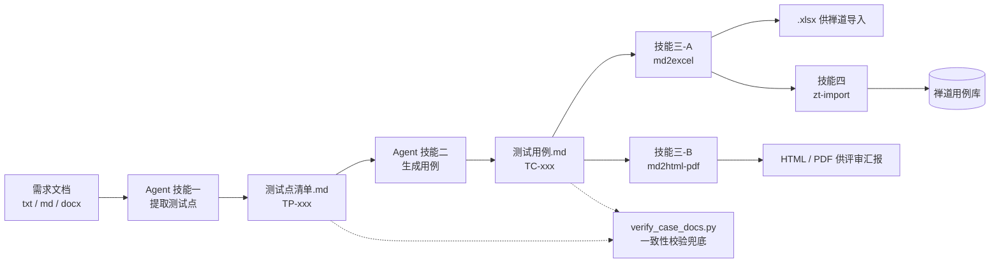

# Req2CaseHelper

> 把需求文档变成可直接导入禅道的测试用例 —— 用 GitHub Copilot Agent + Skills 搭出来的一条测试设计流水线。

**核心理念：让 AI 负责"想"，让脚本负责"稳"，让人负责"拍板"。**



四个技能、一个 Agent、一道校验脚本，全部是 workspace 内的纯文本文件与 Python 脚本——**没有服务端、没有向量库、不依赖任何第三方 AI 平台**。

---

## 它解决什么问题

| 痛点 | 表现 |
|---|---|
| **漏测** | 需求里的功能点藏在列表项中，被当作描述跳过 |
| **AI 爱合并场景** | "含中文 / 含特殊字符 / 纯英文"写成一条用例，实际只执行了其中一个 |
| **格式靠手工搬运** | 禅道只认特定列序的 Excel，评审又需要排版体面的 PDF |
| **经验不可复制** | 老手的直觉（边界在哪？状态除了迁移还能做什么？）极难传递 |

本项目的做法：把这些判断固化成 **Agent 人格 + 禁止事项 + 7 项需求深度扫描**，把重复劳动固化成**技能脚本**，再用一道**校验脚本**兜底。

---

## 能力清单

| 能力 | 实现 | 位置 |
|---|---|---|
| 需求 → 测试点清单 | 测试设计师 Agent（技能一） | `.github/agents/TestDesigner.agent.md` |
| 测试点 → 测试用例 | 测试设计师 Agent（技能二） | 同上 |
| md → Excel（禅道导入格式） | `md2excel` 技能 | `.github/skills/md2excel/` |
| md → HTML / PDF（评审阅读） | `md2html-pdf` 技能 | `.github/skills/md2html-pdf/` |
| Excel → 禅道（自动导入） | `zt-import` 技能 | `.github/skills/zt-import/` |
| 测试点 ↔ 用例一致性校验 | `verify_case_docs.py` | `scripts/` |

---

## 快速开始

### 1. 环境准备

```bash
# 核心依赖（按需，用到哪个装哪个）
pip install openpyxl            # md2excel
pip install markdown markdown-pdf   # md2html-pdf（markdown-pdf 会连带安装 PyMuPDF）
pip install stest              # zt-import（另需 Playwright / AutoIt）
```

### 2. 配置禅道连接

编辑仓库根目录的 `settings.py`，填入你自己的禅道地址与账号：

```python
ZENTAO_URL  = "<你的禅道地址>"
ZENTAO_USER = "<用户名>"
ZENTAO_PWD  = "<密码>"
```

> ⚠️ `settings.py` 含明文凭据，**请勿提交到公开仓库**（详见文末「发布前检查」）。

### 3. 用法

**① 需求 → 测试点 → 用例**（在 VS Code 中操作）

```
@资深测试设计师 请对 docs/需求整理.txt 做测试设计，先输出测试点清单
```

Agent 会先做需求深度扫描、输出测试点清单并**停顿等你确认**，确认后再生成用例。

**② 测试用例 → Excel（禅道导入格式）**

```bash
python .github/skills/md2excel/scripts/md2excel.py
python .github/skills/md2excel/scripts/md2excel.py --split 90 testcases/某个用例.md     # 按条数分页
python .github/skills/md2excel/scripts/md2excel.py --split-module testcases/某个用例.md # 按模块拆分
```

**③ 测试用例 → HTML / PDF（评审阅读）**

```bash
python .github/skills/md2html-pdf/scripts/md_convert.py testcases/某个用例.md
python .github/skills/md2html-pdf/scripts/md_convert.py testcases/某个用例.md -o report/用例.pdf
```

**④ Excel → 禅道（自动导入）**

```bash
# 必须在仓库根目录执行
python .github/skills/zt-import/scripts/zt_import.py \
  -sname <产品下拉名> \
  -mpath /<项目号>/系统管理/用户管理 \
  -tcdir testcases \
  -tcfile 某个用例.xlsx \
  -html report/导入报告.html
```

**⑤ 一致性校验**

```bash
python scripts/verify_case_docs.py \
  -tp testpoints/test_points_xxx.md \
  -tc testcases/test_cases_xxx.md
```

校验 7 项：解析行数、编号重复、TP↔TC 双向映射、编号连续、标题粘连、残留 `[假设]/[待确认]`、汇总统计一致性。退出码：全过 `0` / 有失败 `1` / 缺参数或文件缺失 `2`。

---

## 目录结构

```text
Req2CaseHelper/
├── .github/
│   ├── agents/
│   │   └── TestDesigner.agent.md      # 测试设计师 Agent（人格 + 四技能流程）
│   └── skills/
│       ├── md2excel/                  # md 用例 → xlsx
│       ├── md2html-pdf/               # md → HTML / PDF
│       └── zt-import/                 # xlsx → 禅道
├── design/                            # 设计方案与实践文档
├── docs/                              # 需求整理与实践资料
├── scripts/
│   └── verify_case_docs.py            # 一致性校验
├── testpoints/                        # 测试点清单（测试用例的唯一来源）
├── testcases/                         # 测试用例 + 派生 Excel
├── testdata/                          # 导入去重记录等
├── report/                            # 自动化导入报告
└── settings.py                        # 禅道连接配置（含凭据，勿提交）
```

---

## 文档索引

| 文档 | 内容 |
|---|---|
| **[design/AI测试设计流水线实践.md](design/AI测试设计流水线实践.md)** | **推荐先读**：这条流水线的完整设计思路、7 项深度扫描、踩过的坑与经验反思 |
| [design/AI测试设计流水线实践.html](design/AI测试设计流水线实践.html) | 上述实践文档的 HTML 阅读版 |
| [design/知识点体系设计方案_20260911.md](design/知识点体系设计方案_20260911.md) | 知识点（KP）体系设计稿：一类需求形态 + 完整处理经验 |
| [design/知识书籍库设计方案_20260910.md](design/知识书籍库设计方案_20260910.md) | 知识书籍库设计方案 |
| [design/md2excel分页拆分设计方案_20260909.md](design/md2excel分页拆分设计方案_20260909.md) | md2excel 分页/按模块拆分功能的设计留档 |
| [design/TestDesigner提示词完善方案_20260915.md](design/TestDesigner提示词完善方案_20260915.md) | TestDesigner 提示词完善方案及执行记录 |

各技能的详细用法见其目录下的 `SKILL.md`；Agent 的完整流程与禁止事项见 `.github/agents/TestDesigner.agent.md`。

---

## 约定

| 约定 | 说明 |
|---|---|
| 测试点命名 | `testpoints/test_points_<主题>_<yyyymmdd>.md` |
| 用例命名 | `testcases/test_cases_<主题>_<yyyymmdd>.md` |
| 编号 | 测试点 `TP-<模块>-<三位序号>`；用例 `TC-<模块>-<三位序号>` |
| 数量对应 | 同一批测试点与用例必须**一一对应**（TC-xxx ↔ TP-xxx） |
| 不确定标注 | 需求未明确处必须标 `[假设]` / `[待澄清]`，并在文末汇总成澄清表 |

---

## 设计原则

1. **单一来源** —— 测试点清单是测试用例的唯一来源；脚本只保留一份，不做双份维护。
2. **可追溯** —— 每条用例标注 `关联测试点`，形成 TP ↔ TC 双向映射，由校验脚本保证。
3. **幂等** —— 转换与导入均带记录文件，重复执行自动跳过。
4. **不确定性显式化** —— 需求没写清的地方禁止静默脑补，统一标记并汇总。
5. **确定性的交给脚本，模糊的交给模型** —— 列序、样式、编号、去重、映射校验写死；需求理解、风险判断、场景穷尽交给 Agent。

---

## 安全须知

Fork 或部署本项目时请注意：

- **`settings.py` 含明文凭据**，请加入 `.gitignore`，不要提交
- 建议 `.gitignore` 至少排除：`.venv/`、`__pycache__/`、`settings.py`、`report/`、`screenshot/`、`*.pyc`
- `report/` 下的自动化报告包含禅道页面内容，公开前请自行确认是否脱敏
- `docs/`、`testpoints/`、`testcases/` 内的业务文档可能包含具体项目信息，公开前请自行确认

---

## 说明

- 本项目为**内部实践沉淀**，脚本与流程按实际项目需要持续演进，未做通用化打磨。
- 各技能的参数以 `SKILL.md` 为准；脚本以 `-h` 输出为准。
- `zt-import` 会**真实写入禅道**，执行前请核对产品与模块路径。

---

## 作者

**思文伟** —— 关注测试设计与测试工程化，主要在做“把人的判断经验固化成可执行流程”这件事。
