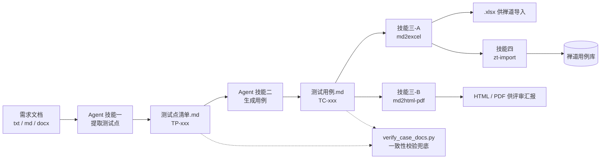

# 用 GitHub Copilot Agent + Skills 打造测试设计流水线：从需求到禅道

> **作者**：思文伟　｜　2026-09

> 把"资深测试设计师"的判断力写成 Agent 的人格与检查清单，把重复劳动写成技能脚本，中间产物一律落成 Markdown 文件，最后再用一道校验脚本兜底。
>
> 项目已在多个真实的影视行业客户项目上跑通：单批产出 30～60 条用例，测试点与用例一一对应可追溯，转换后的表格可直接批量入库禅道。

---

## TL;DR

这条流水线只有一件事：**让 AI 负责"想"，让脚本负责"稳"，让人负责"拍板"。**



四个技能、一个 Agent、一道校验脚本，全部是 workspace 内的纯文本文件与 Python 脚本，**没有任何服务端、没有向量库、不依赖任何第三方 AI 平台**。

---

## 一、为什么"写一句好 prompt"远远不够

最开始我的做法和你一样：把需求粘进对话框，附一句"请帮我设计测试用例"。前几次输出看着挺像样，用上两三批之后问题就全暴露了。

**痛点一：AI 很容易漏掉"藏在列表项里的功能点"。**

需求文档里最常见的写法是这样的：

```text
操作日志：记录表单创建、编辑、发布等全操作流程
```

它以一个列表项的形式挂在"表单信息"下面，看上去像描述，实际上是一个**独立可测的完整功能**。人写文档时顺手就写了，AI 读文档时顺手就跳过了。

**痛点二：AI 天然爱"合并场景"。**

同一个测试意图下的多个等价类，它总喜欢写成一条用例：

> ❌ 用例标题：验证手机号格式（含中文 / 含特殊字符 / 纯英文）
> ❌ 测试步骤：分别尝试 A、B、C 三种场景

这条用例交出去，执行人做一次就算"过了"，剩下两个等价类实际上**从未被执行**。类似地，"部门统筹执行操作 X；部门员工执行操作 Y"这种把多个角色塞进一条用例的写法，也是高频事故。

更隐蔽的是**状态合并**：把"已立项 / 已关闭 / 已作废"三个状态下"编辑按钮不可用"的验证合并成一条。它们断言相同、场景完全不同，合并后一旦只测了其中一个状态，另外两个的回归就彻底失效了。

**痛点三：格式转换靠手工搬运。**

Markdown 用例人和机器都能读，但禅道只认特定列序的 Excel，评审会又需要排版体面的 PDF。于是每次都在"复制粘贴 → 调列宽 → 补固定值"里消耗时间，而且**一定会出错**。

**痛点四：老手的经验不可复制。**

一位干了十几年的测试设计师，看到需求会本能地问几个问题：这个字段的边界在哪？这个状态除了迁移还能做什么操作？A 模块有的校验，B 模块是不是也该有？——这些直觉极难传递，但它恰好是**可枚举的**。

于是我把结论倒过来写：**问题不在于模型不够聪明，而在于我们只给了它一句 prompt，却没给它流程、约束和检查清单。** 所以要把这件事工程化，拆成三层：

| 层 | 载体 | 负责什么 |
|---|---|---|
| **人格 + 流程** | `.github/agents/*.agent.md` | 站在什么立场想问题、按什么步骤走、什么绝对不许做 |
| **可复用能力** | `.github/skills/*/SKILL.md` + `scripts/` | 把一类重复劳动封装成一条命令搞定的事 |
| **确定性兜底** | `scripts/verify_case_docs.py` | 不参与创作，只负责挑错，机器说的话才算数 |

---

## 二、整体设计

### 2.1 目录结构

```text
Req2CaseHelper/
├── .github/
│   ├── agents/
│   │   └── TestDesigner.agent.md      # 资深测试设计师（人格 + 四技能流程）
│   └── skills/
│       ├── md2excel/                  # 技能：md 用例 → xlsx（禅道导入格式）
│       │   ├── SKILL.md
│       │   └── scripts/md2excel.py
│       ├── md2html-pdf/               # 技能：md → HTML / PDF（评审阅读）
│       │   ├── SKILL.md
│       │   └── scripts/md_convert.py
│       └── zt-import/                 # 技能：xlsx → 禅道（自动化导入）
│           ├── SKILL.md
│           └── scripts/zt_import.py
├── docs/
│   └── 需求整理.txt                    # 原始需求
├── scripts/
│   └── verify_case_docs.py            # 一致性校验兜底
├── testpoints/                        # 测试点清单（唯一来源）
├── testcases/                         # 测试用例 + 派生 Excel
├── testdata/                          # 导入去重记录等
└── report/                            # 自动化导入报告
```

### 2.2 职责分工

关键设计在于**别让 AI 干确定性的事，也别让脚本干需要判断的事**：

| 环节 | 谁做 | 为什么 |
|---|---|---|
| 需求结构拆解、风险识别 | Agent | 需要语义理解与领域常识 |
| 测试点提取（含 7 项扫描） | Agent | 需要"想全"的能力 |
| 用例编写（步骤/预期具体化） | Agent | 需要把模糊需求翻译成可执行步骤 |
| 需求与测试点**对照复核** | 人 | 只有业务方知道假设是否成立 |
| 编号连续性、TP↔TC 映射、统计一致 | 脚本 | 纯确定性，AI 做反而不可靠 |
| 列序映射、样式、分页拆分 | 脚本 | 一次性写死，绝不"发挥" |
| 批量入库禅道 | 脚本 | 机械操作，人的价值为零 |

### 2.3 四条设计原则

1. **单一来源**：测试点清单是测试用例的**唯一来源**。生成用例时只能引用测试点，不允许"顺手补几个新想法"。范围扩张必须回到技能一。同样地，技能脚本只保留一份，不做"根目录主脚本 + 技能副本"的双份维护。
2. **可追溯**：每个用例都必须标注 `关联测试点`（TP ID），形成 TP ↔ TC 双向映射。评审时任何一方被改动，另一方立刻能被校验脚本发现。
3. **幂等**：转换与导入都带记录文件（`md2excel_record.json`、`imported_testcase_files.txt`），重复执行自动跳过，不会产生重复数据。需要重跑时用 `--force` 或手动删记录行。
4. **不确定性必须显式化**：需求里没写清楚的地方，禁止 AI 静默脑补。统一用 `[假设]` / `[待澄清]` 标记，并在文末汇总成一张澄清表；涉及未确认结论的断言，一律标注"依赖 Q-xx"，确认后按结论校正。

第四条是我认为**最有价值的一条**。它把"AI 幻觉"这个不可控问题，转化成了"待办清单"这个可控产物——需求方看一眼澄清表就能拍板，而不是在用例里埋一颗不知道什么时候爆的雷。

---

## 三、技能一：从需求提取测试点清单

这是整条流水线的地基。

### 3.1 为什么要有"测试点"这一层中间产物

直接"需求 → 用例"看起来更短，但它有三个致命缺陷：

- **无法评审**：几十条用例里混着几十个测试意图，评审人要同时判断"想全了没"和"写对了没"，认知负荷爆炸。
- **无法追溯**：用例改了以后，没人知道它原本对应哪个需求点，覆盖率变成一笔糊涂账。
- **无法复用**：测试点是**跨轮次稳定**的（需求不变它就不变），用例则会随实现细节反复调整。把易变的部分压在上层，改动成本高一个数量级。

所以流程被强制切成两段，中间**必须停顿**等确认：

> **执行顺序（不可违背）**：必须先执行技能一，得到测试点清单文件后，才能执行技能二。

### 3.2 Agent 的人格与硬约束

`TestDesigner.agent.md` 的开头是一段人设，它不是装饰，而是**决定输出质量的锚点**：

```markdown
> 你是一位拥有 12 年以上软件测试经验的**资深测试设计师**。
> 你精通黑盒测试设计技术：等价类划分、边界值分析、判定表、状态迁移测试、场景法测试。
> 你的工作风格严谨、细致，始终从风险角度出发进行思考。

## 核心原则
- **风险驱动**：优先覆盖高风险区域（数据错误、金额计算、权限、并发、数据丢失等）。
- **从模糊中提取精确**：对不完整的需求，使用 `[假设]` 标记合理推断，并列出需要澄清的问题。
- **强制使用黑盒技术**：等价类、边界值、判定表、状态迁移、场景法（至少应用一项，通常多项）。
- **一场景一用例（强约束）**：每个场景必须对应一条独立用例……
- **一角色一用例（强约束）**：不同角色的测试必须拆分为独立的用例……
- **状态-操作矩阵必查（防遗漏）**：对每个状态/阶段，系统性地枚举该状态下所有可执行的操作……
- **上下文对称性检查（防遗漏）**：同名/同类功能在不同上下文中必须分别覆盖……
- **操作流程完整性（防遗漏）**：测试点不能只覆盖"按钮是否可见/可用"，还必须覆盖点击后的完整流程……
```

注意这里**"禁止事项"写得比"鼓励事项"更狠**。实践证明：对模型说"请考虑得全面一些"几乎没有效果，说"禁止把多个场景写在同一行"却立竿见影。约束写成**可判定的规则**（能一眼看出违反了没有），才真正生效。

### 3.3 七项需求深度扫描

这是整个技能里最"值钱"的部分，也是我把老手直觉显式化的结果。提取测试点之前，必须逐项过一遍：

| # | 检查项 | 要防的问题 | 典型发现 |
|---|---|---|---|
| 1 | **列表项挖掘** | 列表项里的功能点被当作描述跳过 | "操作日志：记录表单创建、编辑、发布等全操作流程"是一个独立功能点 |
| 2 | **模块间对称性** | A 模块有的能力，B 模块漏测 | 两处"待办列表"入口，指派后必须双入口对称验证 |
| 3 | **概览树 vs 详细需求交叉比对** | 概览提到但正文没写，或正文写了但概览没列 | 概览里的模块在详细需求中找不到对应章节 → 标 `[待澄清]` |
| 4 | **空洞内容标记** | "规则如下"后面却没有内容 | 规则编号 1、2、**4**（缺 3）→ 标注疑为笔误，需确认 |
| 5 | **功能原子性** | 把多个独立功能合成一个测试点 | "搜索"和"排序"是两个功能，必须拆开 |
| 6 | **条件分支穷尽** | "或 / 且 / 如果…则"只覆盖了单一分支 | "未创建任何表单**或**所有表单已失效时可作废"实为 3 个分支 |
| 7 | **同类功能横向对比** | 同一功能的不同入口校验规则不一致 | "关联创建"（列表勾选）与"变更关联"（弹窗选择）的选择范围限制不一致 |

#### 一个真实例子：条件分支穷尽

某项目需求里有一句看起来很简单的话：

> 账号密码验证通过后，按"当前浏览器 + 当前账号 + 当日（自然日）"判定有无短信验证通过记录。

直觉上"换个浏览器要重新验证"一句话就覆盖了。但把它拆成真值表，实际是 **4 个组合**：

| 组合 | 账号 | 浏览器 | 预期 |
|---|---|---|---|
| ① | A（当日已验） | X（当日已验） | 直接登录（免验） |
| ② | A（当日已验） | Y（新） | 弹出短信验证（**换设备**重验） |
| ③ | B（新） | X（当日已验） | 弹出短信验证（**换账号**重验） |
| ④ | B（新） | Y（新） | 弹出短信验证（双换均重验） |

再加上"自然日"的时间边界（23:59 前 vs 00:00 后）与"跨浏览器记录互相独立"，一个"一句话需求"最终长成了 6 个测试点。

#### 另一个例子：多档计数器的原子性

需求里同时存在两个上限：

> 一次账号密码验证通过最多 8 条 / 一个账号一个自然日最多 100 条

它们**看着像一回事，其实是两个不同维度的计数器**：一个绑定"会话"，一个绑定"账号 + 自然日"。拆开后各自都有独立的边界（第 8 条 vs 第 9 条、第 100 条 vs 第 101 条）与独立的**重置规则**（重验密码重置 vs 跨自然日清零）。合在一起写，覆盖就必然出现空洞。

### 3.4 输出物结构

技能一的产出是一份 Markdown 清单，结构固定为四段：

```markdown
# [需求名称] 测试点清单

> 生成日期 / 需求 / 覆盖范围

## 一、需求结构分析        ← 层级树 + 深度扫描结论（复杂需求才写）
## 二、风险总览            ← 🔴 高 / 🟡 中 / 🟢 低
## 三、各功能点测试点表格   ← 原子化，一行一个测试点
## 四、待澄清 / 假设汇总    ← 必须存在，不可省略

| ID          | 测试维度 | 所用技术 | 描述                       | 风险 |
|-------------|----------|----------|----------------------------|------|
| TP-SMS-004  | 参数/数据类 | 判定表   | 账号×浏览器四组合验证记录判定 | High |
```

每条测试点固定含五列：`ID`、`测试维度`、`所用技术`、`描述`、`风险`。**描述必须原子化**——禁止用斜杠或顿号并列多个独立场景：

> 如果存在"含中文 / 含特殊字符 / 纯英文"三个等价类，必须拆为 `TP-XXX-001a / 001b / 001c`，不允许挤在同一行。

---

## 四、技能二：从测试点生成测试用例

技能二不"创作"，只"翻译"。

### 4.1 输入输出与映射规则

- **输入**：技能一产出的测试点清单（`.md`）。
- **输出**：与测试点一一对应的测试用例表（`.md`），每条用例可追溯到一或多个 TP ID。
- **规则**：不修改、不删减测试点；不留模糊预期；不把测试点描述原样抄成预期结果。

### 4.2 用例字段规范

| 字段 | 说明 |
|---|---|
| TC-ID | `TC-[模块]-三位数字` |
| 所属模块 | 如"登录-发送控制" |
| 用例标题 | **场景 + 预期结果**，不看步骤就能懂 |
| 关联测试点 | TP ID，可多个 |
| 优先级 | 继承测试点风险，判别规则显式写明 |
| 所用技术 | 与测试点一致 |
| 前置条件 | 具体、可执行（含数据准备） |
| 测试步骤 | 带序号，用中文分号 `；` 分隔 |
| 预期结果 | 可验证、可测量，同样带序号 |

标题写法上坚持一条：**不写"测试 XX 功能"或"XX 验证"这类空洞表述**。对比一下：

| ❌ 空洞标题 | ✅ 场景 + 预期 |
|---|---|
| 测试短信发送上限功能 | 会话内第 9 次触发发送提示超限并跳转 |
| 验证码验证 | 输入错误验证码提示且可重输 |
| 指派功能测试 | 指派后待办从原审核人转移到新审核人 |

第二条标题即使不看步骤，也知道该准备什么数据、该断言什么结果。

### 4.3 约束前后的输出对比

这是最能说明"约束是必需品"的一组例子：

**输入测试点**：

```
TP-SMS-020 | 参数/数据类 | 等价类 | 验证码格式校验（空 / 不足 6 位 / 非纯数字）
```

**❌ 无约束时 AI 的典型输出**（一条顶三条，执行时必然漏）：

| TC-ID | 用例标题 | 测试步骤 | 预期结果 |
|---|---|---|---|
| TC-SMS-020 | 验证码格式校验 | 1. 分别输入空内容、5 位数字、含字母内容；2. 各次点击确认 | 1. 均被拦截并提示；2. 不登录 |

**✅ 加约束后的输出**（甚至更进一层：直接指出这个测试点本身就违反了原子性）：

| TC-ID | 用例标题 | 测试步骤 | 预期结果 |
|---|---|---|---|
| TC-SMS-020a | 验证码为空时被拦截且不登录 | 1. 不输入内容；2. 点击【确认】 | 1. 提示验证码不能为空；2. 弹窗不关闭、不发起校验、不登录 |
| TC-SMS-020b | 验证码不足 6 位时被拦截 | 1. 输入 5 位数字；2. 点击【确认】 | 1. 提示格式错误；2. 不发起校验、不登录 |
| TC-SMS-020c | 验证码含非数字字符时被拦截 | 1. 输入含字母/符号的 6 位内容；2. 点击【确认】 | 1. 提示格式错误；2. 不发起校验、不登录 |

耐心观察上面的过程：约束不是让 AI "多写点"，而是让它**把本来折叠在一起的东西摊开**。

### 4.4 几条用血换来的教训

- **不同状态必须拆**：即使断言完全相同（都是"按钮不可用"），"已立项 / 已关闭 / 已作废"也是三个独立场景。曾有一条用例把三个状态的同类验证合并，事后被拆成三条。
- **同一条件的不同满足方式也要拆**：当条件由多个子条件组合（"均为已发布**或**已生效**或**已失效"），即使指向同一结果，每个子条件仍是独立场景。
- **按钮不能只测可见性**：涉及弹窗的操作必须同时覆盖"确认"和"取消"两条路径——确认后成功、取消后状态不变。
- **同类入口横向对比**：同一模块下不同入口的同类功能（列表勾选 vs 弹窗选择）要把校验规则摆在一起比，差异往往就是漏测点。

---

## 五、技能三：转换格式——一条流水线，两种消费方

Markdown 是**唯一源头**，但它有两个截然不同的下游：

| 消费方 | 格式 | 关心什么 | 技能 |
|---|---|---|---|
| 禅道（机器） | `.xlsx` | 列序、固定值、可导入 | `md2excel` |
| 人 | `.html` / `.pdf` | 排版、可读、可打印、可分享 | `md2html-pdf` |

这个"机器消费 vs 人阅读"的双路设计，是整个流水线里性价比最高的一个决定：**再也不用为了交差把同一份内容整理两遍。**

### 5.1 md2excel：面向禅道的确定性映射

Excel 的列映射是写死的（不做任何"智能推断"）：

```text
所属模块 → 相关需求 → 用例标题 → 前置条件 → 步骤 → 预期
→ 关键词 → 优先级 → 用例类型 → 适用阶段 → 用例状态
```

其中后几列填固定值（优先级 `2`、用例类型 `功能测试`、用例状态 `正常`），样式统一为微软雅黑 Light 11 号 + 蓝灰表头。**固定的事情绝不交给模型决定**——这是它每次都能直接导入成功的原因。

转换结果记录在 `md2excel_record.json`，已转过的文件自动跳过：

```json
[
  { "md": "testcases\\test_cases_X_20260903.md",
    "excels": ["testcases\\test_cases_X_20260903_001.xlsx",
               "testcases\\test_cases_X_20260903_002.xlsx"] }
]
```

`excels` 是**列表**，语义是"该 MD 最近一次生成的输出集合"（替换式更新）。因为一个 MD 可能因为下面这个需求被拆成多个文件——

#### 分页与按模块拆分

禅道单文件导入有行数限制，一套 200 条用例的文档必须拆开。于是脚本增加了两个互斥参数：

```bash
# 按条数分页：每文件最多 90 条，多页加 _001/_002 后缀
python .github/skills/md2excel/scripts/md2excel.py --split 90 testcases/文件.md

# 按"所属模块"拆分：每个模块一个文件
python .github/skills/md2excel/scripts/md2excel.py --split-module testcases/文件.md
```

三条让它"不惹事"的命名规则：

- 用 `_001/_002` 零填充三位，保证**字典序 == 页码序**；
- 拆分后若实际只有 1 个文件，**沿用无后缀原名**，避免无谓改名；
- 模块名做文件名安全化（`/ \ : * ? " < > |` → `_`），重名再加 `_2`、`_3` 消歧。

每个分片都是**独立完整的 workbook**（表头重复、样式一致），因此任一文件都能单独导入。

> 这里踩过一个小坑并留档了：`--split` 用 argparse 的 `nargs='?'` 会**吞掉后面的文件参数**，导致 `--split testcases/a.md` 把路径当成分页数字。解决办法是在 `main()` 里先对 `argv` 做一次预处理，把裸 `--split` 补成 `--split 90`。这类坑不写进文档，下一个人一定会再踩一次。

### 5.2 md2html-pdf：面向人的排版

```bash
# 默认转 HTML（与输入同目录同名）
python .github/skills/md2html-pdf/scripts/md_convert.py testcases/test_cases_X.md

# 转 PDF 并指定输出
python .github/skills/md2html-pdf/scripts/md_convert.py docs/报告.md -o docs/报告.pdf
```

技术选型上，HTML 走 `markdown` 库 + 内嵌 GitHub 风格 CSS；PDF 走 `markdown-pdf`（底层 PyMuPDF），**纯 Python、无系统依赖**，Windows / macOS / Linux 开箱即用。

早期版本我用过 `weasyprint`，结果在 Windows 上报 `OSError: cannot load library 'libgobject-2.0-0.dll'`——需要装 GTK3 运行时。这类"必须在目标机器上装一堆系统库"的方案，在团队推广阶段基本等于不可用。**工具链的部署成本，往往比功能本身更决定它能不能活下来。**

---

## 六、技能四：自动导入禅道

### 6.1 为什么这也要自动化

几十条用例手工导入禅道意味着：登录 → 选产品 → 选模块 → 逐行填字段 → 反复确认。整个过程**没有任何判断**，纯粹是时间黑洞，而且一定会在某一轮出现"导错模块"的事故。

脚本基于 `stest` + Playwright 驱动真实浏览器，一次调用完成：

```bash
python .github/skills/zt-import/scripts/zt_import.py \
  -sname <产品下拉名> \
  -fname <顶部实际显示名> \
  -mpath /<项目号>/系统管理/用户管理 \
  -tcdir D:\workspace\Req2CaseHelper\testcases \
  -tcfile test_cases_X_20260903_001.xlsx test_cases_X_20260903_002.xlsx \
  -html D:\workspace\Req2CaseHelper\report\导入报告.html
```

它还能一次接收多个分片文件，产出 html/xml 双份导入报告，并把成功导入的文件路径逐行记入 `testdata/imported_testcase_files.txt` 去重。

### 6.2 两个必须写进文档的坑

**坑一：脚本位置影响配置查找方向。**

`stest` 默认按"测试类文件的位置向上回溯到第一个非 Python 包目录"来寻找 `settings.py`。当脚本被放进 `.github/skills/zt-import/scripts/` 之后，回溯逻辑就找不到项目根目录的配置了，只报一个语焉不详的 `TypeError: ... NoneType`。

解法是在脚本里内置 `-sfile`（默认 `./settings.py`）并透传给 `stest`，同时明确规定：**必须在项目根目录运行**。这条"运行位置约定"现在被写在技能文档的最显眼处。

**坑二（更重要）：模块路径不能推断。**

分页文件的名字里带着模块名（如 `..._系统管理_用户管理.xlsx`），Excel 里也有一列"所属模块"。看起来完全可以自动映射到禅道的模块路径——**但这个推断是错的**：

> 文档中的模块名是**用例文档的分类名**（`系统管理_用户管理`），而禅道里需要的是**真实模块路径**（`/<项目号>/系统管理/用户管理`）。两者既不相等，也不存在可靠的推导关系。

所以技能文档里写死了一条规则：

> **`-mpath` 必须询问用户，不得从文件名或"所属模块"列推断，也不自动对等。**

这是我在整条流水线里唯一主动**放弃自动化**的地方。原因很简单：**自动化一旦在"看起来能猜"的地方猜错，代价是往生产环境的用例库里写入错误数据**，而修正成本远高于当初多问一句话。

顺便，脚本里还残留着一处 `messagebox.askokcancel("暂停")` 的调试代码——它在文档里被明确标注为"**待移除的调试代码，非必要人工环节**"。宁可写清楚，也不要让下一个人以为"这里弹窗是业务要求"。

---

## 七、兜底：一致性校验脚本

`scripts/verify_case_docs.py` 不参与创作，只负责挑错——**机器说的话才算数**。

```bash
python scripts/verify_case_docs.py \
  -tp testpoints/test_points_X_20260907.md \
  -tc testcases/test_cases_X_20260907.md \
  --warn-pending
```

它检查 7 项：

| # | 校验项 | 说明 |
|---|---|---|
| 1 | 解析行数 | 测试点与用例表格的行数量 |
| 2 | 编号重复 | 是否存在重复 TP/TC 编号 |
| 3 | **一一映射** | 每个 TC 是否有对应 TP，**双向**检查 |
| 4 | 编号连续 | 各前缀编号是否从 1 连续递增 |
| 5 | 标题粘连 | `## xxxx` 标题行后是否直接粘上了表格（标题行内含 `\|`） |
| 6 | 残留标记 | `[假设]` / `[待确认]` 计数（`--strict-pending` 可判为失败） |
| 7 | 汇总一致性 | 文末"汇总统计"表的数量是否与实际解析一致 |

第 5 项看起来琐碎，但它修的是真实缺陷：**标题和表格粘连会导致 Markdown 渲染时表格丢失表头**，导出成 HTML 后整张表错位。这种问题靠肉眼审阅几乎发现不了。

### 一个刻意的"不便"设计

`-tp` 与 `-tc` 都是**强制必填**参数，不提供任何默认值：

> 未提供时不推断、不自动发现、不猜测目标文件，直接报错退出（退出码 2）。

因为一个校验脚本最大的风险不是"漏报"，而是**"校验了错误的文件却报告通过"**。那种"绿色通过"带来的虚假安全感，比不校验更危险。

退出码也做了约定：全过 `0`、有失败项 `1`、缺参数或文件不存在 `2`——可以直接挂进 CI，让"用例与测试点不同步"在提交阶段就被拦住。

---

## 八、经验与反思

跑了这么多批需求之后，沉淀下来几条我认为**可以迁移到任何 AI 工作流**的经验。

**1. "禁止事项"比"鼓励事项"有效得多。**

"请全面考虑"是无效指令；"禁止用斜杠在同一行描述多个独立场景"是可判定指令。写 Agent 定义时，我会刻意把篇幅留给禁令——因为它们可以被检查、被验证、被纠正。

**2. 中间产物 > 一步到位。**

需求 → 测试点 → 用例，看起来多了一道工序，实际上每一层都带来：可评审、可追溯、可复用、可校验。**AI 的可靠性来自"每一步都能被人拦住"，而不是"一次输出得更聪明"。**

**3. 把老手的直觉写成检查清单。**

那 7 项扫描没有任何技术含量，就是一位老测试看到需求时会本能问的问题。但把它写下来之后，它就变成了**新人也能用、AI 也能执行**的流程。这大概是整套方案里最像"真正的知识转移"的部分。

**4. 让 AI 暴露不确定性，而不是掩盖它。**

`[假设]` / `[待澄清]` / `依赖 Q-xx` 这套机制的价值在于：把"幻觉"这个不可观测的风险，变成了"澄清表"这个可交付的产物。需求方看完澄清表拍个板，整批用例的可信度立刻提升一个档次。

**5. 确定性的事交给脚本，模糊的事交给模型。**

列序、样式、编号、分页、去重、映射校验——这些**写一次就永远正确**的事，一旦交给模型就永远不稳。反过来，需求理解、风险判断、场景穷尽——这些脚本永远做不好的事，才是模型的主场。分清这条线，是这套方案能稳定运行的根本原因。

**6. 顺便说说局限。**

- **需求质量仍是上限**：文档里没写清的东西，AI 只能标记出来，不能替业务方拍板。澄清表最终还是要人去问。
- **只到"用例入库"为止**：目前没有覆盖用例的**自动执行**，也就是从"测试设计自动化"到"测试执行自动化"这一跳还没走。
- **调试代码需要持续清理**：脚本里的临时弹窗、临时代码是真实存在的技术债，只能靠文档标注 + 定期清理来兜。
- **跨会话的记忆需要主动沉淀**：业务背景（如"某影视行业客户项目"里复杂的审批链路与角色体系）与工具踩坑，都要写进仓库级记忆文件。否则下一次对话，模型又要从零理解一遍业务。

---

## 九、附录：如何在你自己的项目里落地

### 9.1 最小可用版本（半天可完成）

别一上来就搭四个技能，先做**技能一 + 技能二**，这是收益最集中的部分：

```text
your-project/
├── .github/
│   └── agents/
│       └── TestDesigner.agent.md    # 人设 + 核心原则 + 7 项扫描 + 输出模板
├── docs/
│   └── 需求.txt
├── testpoints/                      # 测试点清单产出目录
└── testcases/                       # 测试用例产出目录
```

### 9.2 需要准备的三样东西

1. **一份 Agent 定义**（`.github/agents/TestDesigner.agent.md`）：人设 + 黑盒技术清单 + **禁止事项** + 输出模板。核心是可判定的约束，不是华丽的描述。
2. **一个输出模板**：测试点清单四段式（结构分析 / 风险总览 / 测试点表格 / **待澄清汇总**）。模板固定了，批量产出的一致性才有保障。
3. **一套编号规范**：`TP-<模块缩写>-<三位序号>` 与 `TC-<模块缩写>-<三位序号>`。这是后面一切追溯与校验的基础。

### 9.3 一句可以直接用的启动 prompt

```text
请阅读 docs/需求.txt，按资深测试设计师的流程：
1. 先做需求深度扫描（列表项挖掘 / 模块间对称性 / 条件分支穷尽等 7 项），
   将结论写进「需求结构分析」；
2. 提取测试点清单，保存到 testpoints/；
3. 列出「待澄清 / 假设汇总」，等我确认后再生成用例。

注意：严格遵守一场景一用例、一角色一用例；禁止用斜杠或顿号在同一行描述多个独立场景。
```

最后那条"禁止"，就是这条流水线能产出可用结果的全部秘密。

---

## 相关文件速查

| 能力 | 位置 |
|---|---|
| 测试设计师 Agent | `.github/agents/TestDesigner.agent.md` |
| md → Excel（禅道导入） | `.github/skills/md2excel/` |
| md → HTML / PDF（评审阅读） | `.github/skills/md2html-pdf/` |
| Excel → 禅道（自动导入） | `.github/skills/zt-import/` |
| 一致性校验 | `scripts/verify_case_docs.py` |

> 本文描述的全部能力均已在真实项目中投入使用，脚本与技能文档位于上述路径；如需在新项目中复用，直接复制 `.github/` 与 `scripts/` 两个目录即可。

---

## 关于作者

**思文伟** —— 关注测试设计与测试工程化，主要在做“把人的判断经验固化成可执行流程”这件事。

本文是 **Req2CaseHelper** 项目的配套文档：

- **Agent 与技能**：`.github/agents/`、`.github/skills/`
- **校验脚本**：`scripts/`
- **文档与知识内容**：`docs/`、`knowledge/`

> 如需转载或引用，请注明作者 **思文伟** 与来源，并指明是否作出修改。
