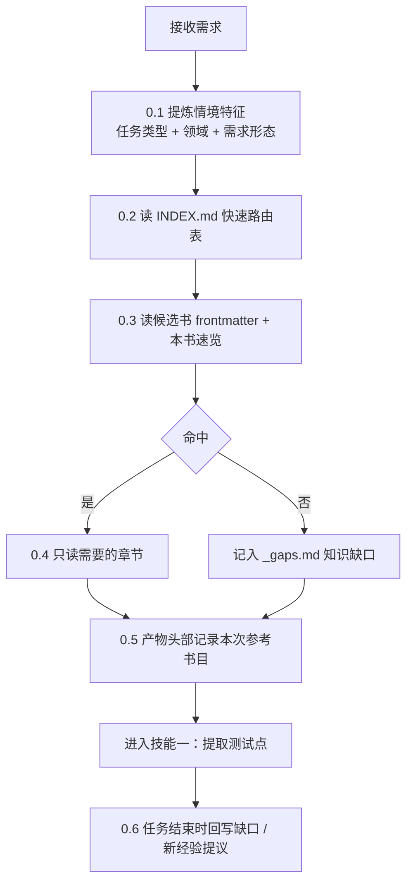

# 知识书籍库（books/）设计方案

> - 日期：2026-09-10
> - 状态：**设计稿（未实现）**
> - 定位：跨项目可复用的**方法论知识库**，为 Agent 提供"任务开始前该参考哪些经验"的检索能力
> - 关联：`.github/agents/TestDesigner.agent.md`（检索流程接入点）、`scripts/verify_case_docs.py`（校验脚本风格参考）

---

## 一、目标与背景

### 1.1 要解决的问题

当前项目的知识散落在四类载体中，**缺少"方法论"这一层**：

| 载体 | 存什么 | 现状问题 |
|---|---|---|
| `.github/skills/*/SKILL.md` | 工具怎么用 | 只讲操作，不讲判断 |
| `/memories/repo/*.md` | 工具踩坑、项目业务背景 | 按工具/项目切碎，无主题聚合 |
| `docs/*.md` | 本次需求整理、设计方案 | 生命周期短，随需求结束而失效 |
| `testpoints/` `testcases/` | 交付产物 | 一次性，不可复用 |

结果：**"怎么设计"这类方法论知识只活在对话上下文里，一场对话结束就蒸发**。同一类坑会在不同项目里反复踩。

### 1.2 目标

1. 把**跨项目可复用的方法论**沉淀为独立的、可检索的知识单元（"书"）。
2. 让 Agent 在每次任务开始前，**自动检索并加载相关经验**，而不是靠模型自觉。
3. 让知识库本身**可读、可评审、可 diff、零依赖**（Git 友好，不引入向量库/服务端）。

### 1.3 核心理念

> 用**可读的索引**替代向量检索；用**情境主键 + 反向校验**替代关键字匹配。

| 维度 | 向量库 / RAG | 本方案（摘要 + 情境索引） |
|---|---|---|
| 可读性 | ❌ 黑盒，不可评审 | ✅ 人可直接读、直接改、直接 diff |
| 依赖 | 需 embedding 服务 | 零依赖，纯 Markdown |
| 修正成本 | 需重算索引 | 改一行文字 |
| 规模上限 | 大 | 约 20~60 本舒适，60+ 需二级索引 |

对个人/小团队的私有知识库而言，**"可读可改"比"检索精度"更重要**。

---

## 二、关键设计决策

### 决策一：索引主键是「情境」，不是「关键字」

**这是本方案最重要的一条。**

方法论类知识的触发词，**通常不会出现在需求文本里**。需求里不会写"这里请用边界值分析"，但设计者需要边界值分析。因此若以关键字作为检索主键，会**系统性地漏掉最有价值的书**。

所以 `INDEX.md` 的主键为 **任务类型 × 领域情境**，关键字退居辅助位：

- ❌ 主键：`等价类, 边界值, 判定表`
- ✅ 主键：`提取测试点 / 评审完备性时`、`需求含表单、字段录入、增删改查时`

判断"我现在是不是在处理这种情境"比判断"这个词是不是我的关键字"可靠得多。

### 决策二：书必须「可分级加载」

一本书可能很长，全量读进上下文是浪费。书相比普通文档的独特价值在于**可以渐进加载**：

1. 读 frontmatter + `本书速览`（约 20 行）→ 判断是否有用；
2. 命中则**只读需要的章节**（每章开头有一句「本章摘要」）。

这样一本书无论多长，**检索成本都是常数级**。

### 决策三：书里只放方法论，不放项目事实

- **方法论**（等价类怎么用、审批流该怎么拆）→ 生命周期以**年**计，适合入书。
- **项目事实**（某项目某字段 100 字符上限）→ 生命周期以**月**计，几个月后即成误导源。

> 反例留档：已于 2026-09-10 删除的 `docs/requirements_background.md` 就是"把项目事实当知识库"的典型失败——它记录的是具体字段规则，三个月后既无人维护、也不再准确。

**项目事实的归属**：`/memories/repo/` 或本次 `docs/` 需求整理，不入书。

### 决策四：入书必须经人确认

AI 只负责**提议**（建议新增/修订哪一章），人确认后才写入。

理由：若每轮对话都让 AI 自动写书，会以每周几本的速​​度生产重复且低质的内容——**知识库会死于膨胀，而不是死于匮乏**。

---

## 三、目录结构

```text
books/
├── INDEX.md                       # 唯一检索入口（索引）
├── _gaps.md                       # 知识缺口台账（反向校验产出）
├── 测试设计通用原则.md
├── 需求澄清问题清单.md
├── 用例书写规范.md
└── 表单类需求测试要点.md
```

**默认形态：一本书 = 一个文件。**

当单本书超过 **800 行**（阈值可配）时，才升级为目录形态：

```text
books/
└── 表单类需求测试要点/
    ├── BOOK.md                    # frontmatter + 本书速览 + 章节导航
    └── 01-字段校验.md
```

> 升级形态是**预案而非默认**。过早拆分会增加维护成本，且大部分书永远不会长到 800 行。

---

## 四、书的规范

### 4.1 Frontmatter（必填）

```yaml
---
type: book
title: 表单类需求测试要点
summary: 一句话说明本书解决什么问题（≤80 字，用于索引展示）
when_to_read:                        # 情境主键，最重要
  - 需求含表单、字段录入、增删改查
  - 需要设计字段级校验用例
not_for:                             # 反向边界，防止误翻
  - 纯流程审批类需求（见《审批流测试要点》）
task_types: [提取测试点, 生成用例]     # 任务类型，索引的另一个主键
domains: [表单, 数据校验]
keywords: [必填, 长度, 唯一性, 二次确认, 富文本]   # 辅助，不作主键
volatility: stable                   # stable | evolving | time-sensitive
sources:                             # 原料来源，可追溯
  - 项目A_20260731 澄清记录 Q3/Q7
last_reviewed: 2026-09-10
review_due: 2027-03-10               # volatility=time-sensitive 时必填
---
```

**字段说明**

| 字段 | 必填 | 说明 |
|---|---|---|
| `title` | ✅ | 书名，与文件名一致 |
| `summary` | ✅ | ≤80 字，说明"解决什么问题"，不是"讲了什么" |
| `when_to_read` | ✅ | **情境主键**。为空 = 这本书永远不会被检索到，校验脚本判为失败 |
| `not_for` | 建议 | 明确不适用场景，降低误翻率 |
| `task_types` | ✅ | 提取测试点 / 生成用例 / 评审 / 需求澄清 / 交付入库 |
| `keywords` | 建议 | 仅辅助；跨书完全重复时触发概念冲突预警 |
| `volatility` | ✅ | `time-sensitive` 的书必须填 `review_due` |
| `sources` | 建议 | 原料来源（哪个项目的哪条澄清/教训），保证可追溯 |
| `last_reviewed` | ✅ | 最近复核日期 |

### 4.2 正文结构（固定）

```markdown
## 本书速览
- 第一章 一句话摘要
- 第二章 一句话摘要

## 1. 适用场景
本章摘要：一句话
……

## 2. 核心规则
本章摘要：一句话
……

## 3. 检查清单
本章摘要：一句话
- [ ] 可直接复制进任务执行的清单项
- [ ] ……

## 4. 反例与教训
本章摘要：一句话
（来自真实项目的脱敏案例：原本做法 → 问题 → 正确做法）

## 5. 关联书籍
- 《审批流测试要点》——本文第 2 章的前提概念
```

**要点**

- `本书速览` 与各章 `本章摘要` 是**分级加载的基础设施**，不可省略（校验脚本会检查）。
- `检查清单` 章节是本方案最实用的部分：**书可以被阅读，清单可以被机械执行**。
- `反例与教训` 只保留脱敏后的方法论结论，不保留项目专有事实。

---

## 五、索引规范（INDEX.md）

`INDEX.md` 分两段：**快速路由表**（低成本定位）+ **书目总表**（完整信息）。

```markdown
# 知识书籍库索引

> 检索方式：先按【任务类型】筛，再按【情境】匹配；`keywords` 仅作辅助。

## 一、快速路由（任务类型 → 推荐书目）

| 任务类型 | 推荐书目 |
|---|---|
| 提取测试点 | 《测试设计通用原则》《表单类需求测试要点》 |
| 生成用例 | 《用例书写规范》《测试设计通用原则》 |
| 需求澄清 | 《需求澄清问题清单》 |
| 交付入库 | 《禅道交付规范》 |

## 二、书目总表

| 书 | 摘要 | 什么时候该翻（情境主键） | 任务类型 | 稳定性 | 最近复核 |
|---|---|---|---|---|---|
| 测试设计通用原则 | 黑盒技术与漏测防范 | 提取测试点 / 评审完备性时 | 提取测试点、生成用例 | stable | 2026-09-10 |
| 表单类需求测试要点 | 表单的校验与交互漏测清单 | 需求含表单、字段录入、增删改查时 | 提取测试点、生成用例 | evolving | 2026-09-10 |
```

路由表刻意保持 **10 行以内**——它是 Agent 每次任务都要读的部分，必须便宜。

---

## 六、检索流程（技能零）

检索不能靠模型自觉，必须写进 Agent 的固定流程，作为**技能零**前置：



**执行要求**

| 步骤 | 要求 |
|---|---|
| 0.1 | 提炼 3~8 个情境特征，不允许跳过 |
| 0.2 | **必须读** `INDEX.md` 路由表；即使判断"无书可参考"也要读 |
| 0.3 | 先读 frontmatter + 速览，禁止直接全量读取整本书 |
| 0.5 | 产物（测试点清单 / 用例）头部加一行：`> 参考书籍：《X》第2章、《Y》第3章` |
| 0.6 | 任务结束时：① 记录未被覆盖的情境 → `_gaps.md`；② 提议可沉淀的新经验（**等人确认**） |

> 与现有流程一致：这和你"必须先执行技能一才能执行技能二"是同一种手法——**用流程锁住行为，而不是用期望**。

---

## 七、反向校验闭环

索引型方案不会"检索错"，它会**漏检且不报错**。这是本方案最大的风险，唯一对抗手段是反向校验。

| 方向 | 做法 | 产出 |
|---|---|---|
| 正向 | 情境 → 书（检索） | 本次参考书目 |
| **反向** | 本次实际用到的概念 → 是否有书覆盖 | **知识缺口台账 `_gaps.md`** |

```markdown
# 知识缺口台账

> 由任务结束时的反向校验自动追加；人工定期审视后决定处置。

| 日期 | 情境 | 缺口概念 | 处置 |
|---|---|---|---|
| 2026-09-10 | 密钥延期首次/非首次控制 | 状态互斥的发起控制模式 | 待定：并入《审批流测试要点》第3章 |
| 2026-09-12 | 富文本上传 | 文件格式/大小校验通用规则 | 忽略（低频） |
```

**副作用收益**：缺口台账顺便回答了"下一本该写什么书"，让知识库的增长由**真实缺口驱动**，而不是由"想到什么写什么"驱动。

---

## 八、可度量指标

`0.5` 步骤产生的"参考书目"记录，让知识库的价值变得可度量：

| 指标 | 含义 | 处置 |
|---|---|---|
| 引用次数 = 0 的书 | 从来没被检索到 | **索引写错了，或这本书该删** |
| 引用次数最高的书 | 核心资产 | 优先投入维护 |
| `_gaps.md` 条目 ≥ 3 的同主题缺口 | 系统性知识空白 | 立项写新书 |
| 跨书 `keywords` 完全重复 | 概念冲突风险 | 合并或明确分工 |

**"零引用的书 = 该删除或索引写错了"** 是维持知识库健康最有效的单一指标。

---

## 九、校验规则

建议新增 `scripts/verify_books.py`（与 `verify_case_docs.py` 同风格：纯标准库、退出码 0/1/2）。

| # | 校验项 | 级别 |
|---|---|---|
| 1 | 每本书 frontmatter 完整，`title`/`summary`/`when_to_read`/`task_types`/`volatility`/`last_reviewed` 齐全 | FAIL |
| 2 | `INDEX.md` 条目 ↔ 实际书文件**双向**一一对应（缺一即失败） | FAIL |
| 3 | `when_to_read` 非空（为空 = 永远检索不到） | FAIL |
| 4 | 正文包含 `## 本书速览` 且每章含摘要行（保证可分级加载） | FAIL |
| 5 | `volatility=time-sensitive` 必须有 `review_due`；已过期 → 警告 | WARN |
| 6 | 书内 `关联书籍` 指向的书存在 | FAIL |
| 7 | 跨书 `keywords` 完全重复 → 概念冲突预警 | WARN |
| 8 | 书过短（< 30 行）→ 提示与其他书合并 | WARN |
| 9 | `_gaps.md` 中超期未处置的条目 → 提醒 | WARN |

**退出码约定**（沿用现有习惯）：全过 `0`；有 FAIL `1`；缺参数/文件不存在 `2`。

---

## 十、硬规则（防烂，必须写死在文档里）

1. **书里只放方法论，不放项目事实。** 混放会导致二者一起烂掉。
2. **一个概念只能有一个"主书"。** 别处一律引用。两本书对同一概念给出不同口径时，无人知道该信谁。
3. **入书必须经人确认。** AI 只提议，不直接写。
4. **原料必须是真实项目验证过的经验。** 禁止凭空生成——"看着对、用起来错"的书比没有书更危险。
5. **`when_to_read` 不可为空。** 没有情境主键的书，等于不存在的书。
6. **书与索引必须同步更新。** 改书不改索引 = 索引说谎，由校验脚本兜底。
7. **多书冲突时以"更专门的书"优先**（specificity 优先），并在任务中显式提示冲突，不静默取舍。

---

## 十一、边界情况清单

| # | 场景 | 处置 |
|---|---|---|
| 1 | 书被删除但 `INDEX.md` 未更新 | 校验脚本判 FAIL（校验项 2） |
| 2 | 两本书覆盖同一概念 | 校验项 7 预警；人工指定主书，另一本改为引用 |
| 3 | 一次任务同时命中多本书且口径冲突 | 按"更专门优先"，并在产物中标注冲突供人工裁决 |
| 4 | 某本书长期零引用 | 审视：索引情境写错 / 内容已过时 / 该删除 |
| 5 | 书中混入项目专有事实 | 移出至 `/memories/repo/` 或 `docs/` 需求整理 |
| 6 | 单本书超过 800 行 | 升级为目录形态（`BOOK.md` + 章节文件） |
| 7 | 新需求完全无书覆盖 | 记入 `_gaps.md`，本次按通用原则执行，不阻断流程 |
| 8 | `INDEX.md` 膨胀超过 ~100 行 | 见"十二章：规模临界点" |

---

## 十二、规模临界点

| 书量 | 索引策略 |
|---|---|
| < 20 本 | `INDEX.md` 单表即可，路由表 + 总表 |
| 20~60 本 | `INDEX.md` 按 `domains` 分组，路由表仍需 ≤ 10 行 |
| > 60 本 | **先考虑合并**（多半是拆分过细）；确需保留则引入二级索引（领域 → 索引），或改用真正的向量检索 |

> 默认预期：**长期维护规模在 10~30 本**。超过这个数量，通常是"书"的粒度定错了。

---

## 十三、初始书目建议（从现有资产反推）

知识的**原料**应当是"真实项目里验证过的经验"。现有资产可直接转化为种子书：

| 建议书 | 原料来源 |
|---|---|
| 《测试设计通用原则》 | `TestDesigner.agent.md` 的核心原则 + 7 项需求深度扫描 |
| 《需求澄清问题清单》 | 各批次测试点清单的 `[待澄清]/[假设]` 汇总，尤其是"已确认"的条目 |
| 《用例书写规范》 | 技能二字段规范、标题写法、一场景一用例/一角色一用例规则 |
| 《表单类需求测试要点》 | 多次表单类需求（字段校验、状态操作、二次确认）的横向经验 |
| 《审批流测试要点》 | 影视审批链路类需求（节点、会签、退回、待办转移）的共性经验 |
| 《禅道交付规范》 | `md2excel` 列序固定值、`zt-import` 的模块路径不对等约定 |

> **最高密度的原料来源**：每条 `[待澄清] → 已确认` 的记录背后，都是一个"容易被误解的需求点"。这是比"让 AI 凭空总结测试原则"更有价值的输入。

---

## 十四、待确认决策项

| # | 决策项 | 选项 | 建议 |
|---|---|---|---|
| 1 | 目录命名 | `books/` / `playbooks/` / `knowhow/` | **`books/` 可用，但需警惕隐喻**："书"暗示完整性，会诱导写得又长又全；而这类知识的价值恰在原子、可查。选 `books/` 就要靠规则约束篇幅 |
| 2 | 默认形态 | 单文件 / 目录 | 单文件；> 800 行才升级 |
| 3 | 是否保留项目案例 | 完全不留 / 脱敏保留在"反例与教训"章 | 脱敏保留（否则方法论缺乏说服力） |
| 4 | 检索是否强制 | 强制读 `INDEX.md` / 建议读 | 强制（否则必然退化为不读） |
| 5 | 校验脚本 | 独立 `verify_books.py` / 并入 `verify_case_docs.py` | 独立（职责不同，参数语义也不同） |

---

## 十五、分期实施清单（均未实现）

**一期：最小可用**
- [ ] 建立 `books/` 目录与 `INDEX.md`（路由表 + 总表）
- [ ] 写 2~3 本种子书（建议从《测试设计通用原则》《需求澄清问题清单》开始）
- [ ] 定稿 frontmatter 与正文结构规范

**二期：接入流程**
- [ ] `TestDesigner.agent.md` 增加"技能零：知识检索"及其执行要求
- [ ] 产物头部增加"参考书籍"记录行

**三期：闭环与治理**
- [ ] `scripts/verify_books.py` 九项校验
- [ ] `_gaps.md` 反向校验闭环
- [ ] 引用次数统计与"零引用书"定期审视机制

---

## 十六、方案自评

**这个方案最可能失败在哪？**

不是检索不准，而是**没有人持续往里写**。一份需要在每轮任务后多花 10 分钟沉淀的知识库，通常活不过两个月。

因此落地时最该守住的不是"规范有多完整"，而是**入书门槛足够低**：哪怕只是一条 3 行的检查项，只要进了书、被引用过，就比一篇写得很漂亮但没人读的长文有价值。

**判断这个方案是否成功的唯一标准**：三个月后，**是否每次任务都真的读了 `INDEX.md`**。若没有，其余设计都是装饰。
