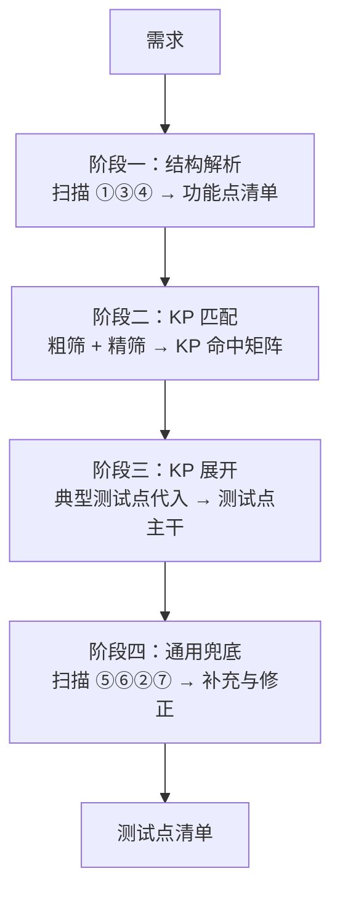

# 知识点（KP）体系设计方案

> - 日期：2026-09-11
> - 状态：**设计稿（未实现）**
> - 关联目录：`knowledge/`
> - 关联文件：`.github/agents/TestDesigner.agent.md`（检索流程接入点）、`scripts/verify_case_docs.py`（校验风格参考）
> - **本文取代 `design/知识书籍库设计方案_20260910.md` 的"书 + 索引"方案**；该文中的"书"在本方案中降级为**可选延伸**（当某个 KP 的详节超出长度阈值时才升级为书）

---

## 一、目标与背景

### 1.1 要解决的问题

本项目已有的四类知识载体，各自职责清晰，但**缺少"方法论"这一层**：

| 载体 | 存什么 | 生命周期 |
|---|---|---|
| `.github/skills/*/SKILL.md` | 工具怎么用、交付规范 | 长 |
| `/memories/repo/*.md` | 工具踩坑、当前项目的业务背景 | 中 |
| `docs/*.md` | 本次需求的整理、设计方案 | 随需求 |
| `testpoints/`、`testcases/` | 交付产物 | 一次性 |

结果：**"这类需求要测什么、要问什么"这类方法论知识，只活在对话上下文和各批文档的零散章节里，一场对话结束就蒸发。**

### 1.2 实测证据

对本项目 12 批、**795 条测试点**做统计：

| 指标 | 数值 |
|---|---|
| "测试维度"列的不同取值 | **203 个** |
| 前 7 个高频取值占比 | 68.9% |
| 只出现 1 次的取值 | 171 个 |
| **出现 ≤2 次的取值** | **187 个 → 占全部取值的 92%** |

**结论：这一列是自由填写的，已退化成"备注"。** 92% 的分类值不复用，说明它既不能被统计、也不能被校验、更不能被挂载知识。

这直接证明了两件事：

1. **不设枚举 ⇒ 分类失效**；
2. 部分批次（如短信验证批次）其实已自发形成了规范分类，说明**规范是能做到的，只是没有强制**。

### 1.3 核心思路

> **知识点（KP）= 一类需求形态 + 该形态的完整处理经验。**

"处理经验"至少包含四个面，本方案覆盖前两个（它们天然共用一张表）：

| # | 面 | 本方案 |
|---|---|---|
| 1 | 要测什么 → **典型测试点** | ✅ |
| 2 | 要问什么 → **典型澄清问题** | ✅ |
| 3 | 要注意什么风险 → 风险提示 | ⏸ 后续按需 |
| 4 | 交付规范 | ✅ 已有载体（`skills/`） |

### 1.4 为什么"澄清问题"必须并入

每个 KP 的"典型测试点"与"典型澄清问题"高度重叠——**边界在哪、口径是什么、重置规则是什么，既是要测的，也是要问的**。实测印证：

| 既有澄清记录 | 对应的 KP 条目 |
|---|---|
| `Q-SMS-04` 重验密码后计数是否重置 | KP-计数-001 第 3 条（重置规则） |
| `Q-SMS-05` 发送失败是否计入成功条数 | KP-计数-001 第 2 条（计数口径） |
| `Q-SMS-11` 100 条/日上限是否可配 | KP-计数-001 第 5 条（上限后的出路） |

**同一件事的两个用法：一个变成测试点，一个变成要问需求方的问题。** 加一列的边际成本接近于零，收益是把澄清从"碰到才问"变成"按形态问"。

---

## 二、概念与术语

### 2.1 三层关系

```
KP（知识点）    →    TP（测试点）    →    TC（测试用例）
一类需求形态         要测什么            怎么测
```

| 缩写 | 全称 | 中文 |
|---|---|---|
| **KP** | **K**nowledge **P**oint | 知识点 |
| **TP** | **T**est **P**oint | 测试点 |
| **TC** | **T**est **C**ase | 测试用例 |

ID 规范：`KP-<域>-<三位序号>`、`TP-<模块>-<三位序号>`、`TC-<模块>-<三位序号>`。统一三位数字，保证**字典序 = 编号序**。

### 2.2 知识点 ≠ 测试技术（关键判据）

| | 是 KP？ | 判据 |
|---|---|---|
| `边界值分析` | ❌ 测试技术 | 需求里**看不到**"边界值"三个字 |
| `多档计数器` | ✅ 知识点 | 需求里**能看到**"最多 8 条 / 每天 100 条" |
| `判定表` | ❌ 测试技术 | 需求里看不到 |
| `会签与待办转移` | ✅ 知识点 | 需求里能看到"部门主管审核 ‖ 板块负责人" |

> **判据：`识别信号` 必须是需求里能直接看到的特征。看不到的，归 7 项扫描，不进 KP。**

### 2.3 知识点 ≠ 7 项需求深度扫描（互补关系）

| | 7 项扫描 | 知识点 |
|---|---|---|
| 是什么 | 怎么读、怎么想（**技术**） | 需求长什么样（**对象**） |
| 执行条件 | **无条件**，每个需求都跑 | **按需**，命中才生效 |
| 回答的问题 | "我漏了吗" | "我该看哪本书 / 该测什么" |
| 作用 | 防**未知** | 覆盖**已知模式** |

**两者互补，不互相替代。** 流程上：先用 KP 覆盖已知形态，再用 7 项扫描兜底未知角落。

---

## 三、文件组织

### 3.1 目录结构：一个 KP 一个文件

```text
knowledge/
├── KP-变更-001-存量数据兼容.md
├── KP-变更-002-改名与引用面清理.md
├── KP-范围-001-枚举清单完整性核对.md
├── KP-计数-001-多档计数器.md
├── KP-流程-001-待办与消息转移.md
├── KP-时效-001-时间窗口与倒计时.md
├── KP-时效-002-有效期与失效.md
├── KP-数据-001-字段校验.md
├── KP-状态-001-状态机.md
└── KP-权限-001-权限与角色差异.md
```

### 3.2 命名规范

```text
KP-<域>-<三位序号>-<形态名>.md
```

| 规则 | 理由 |
|---|---|
| ID 在前 | 排序稳定、天然按域分组 |
| 用连字符，不用空格 | PowerShell / bash 下无需引号 |
| **形态名必须是"需求里能看到的形态"** | "存量数据兼容"可判断；"数据治理""质量保障"无法判断，禁止 |

### 3.3 单文件内部结构

```markdown
---
kp: KP-计数-001
name: 多档计数器
domain: 计数
---
# KP-计数-001 多档计数器

## 识别信号
出现多个不同维度的数量上限（"最多 8 次/会话" + "每日 100 次"）。
线索词：上限、最多、每日、次数限制、配额

## 典型测试点
1. 边界：第 {N} 条正常 / 第 {N+1} 条触发限制 —— 每个上限各一组
2. 计数口径：{计入口径} 不满足时是否计入
……

## 典型澄清问题
1. 计数口径是什么？成功才计，还是调用即计？
……

## 出处书
（空 = 知识缺口）
```

### 3.4 为什么是"多文件"，而不是"单文件 + 索引"

| | 单文件 | 独立索引 + 单文件 | **多文件（本方案）** |
|---|---|---|---|
| 阶段二 token | 读全量（10 KP ≈ 500 行） | 读索引（小） | 读**目录列表**（10 行）+ 命中的几个文件 |
| 索引 drift | 不存在 | ❌ 需双写，必然 drift | ✅ **目录列表自动生成，不可能 drift** |
| 随 KP 增长 | 线性变贵，且过长会被"略读" | 索引也要同步维护 | 成本与总数弱相关 |
| 维护动作 | 加一行 | 加一行 + 加一文件 | **加一个文件** |

> **"目录列表天生就是索引"——这是本方案的核心简化。** 加一个文件，列表自动多一行；删一个文件，自动少一行。没有任何东西需要同步。

**实测 token 账**（每 KP 文件约 40 行）：

| 场景 | 单文件 | 多文件 |
|---|---|---|
| 10 KP，命中 4 个 | 500 行 | 10 + 4×40 = **170 行** |
| 30 KP，命中 5 个 | 1500 行 | 30 + 5×40 = **230 行** |

### 3.5 增长路径（不需额外设计）

| KP 数量 | 形态 | 目录列表长度 |
|---|---|---|
| 10 | 平铺 | 10 行 ✅ |
| 30 | 平铺 | 30 行，仍可用 |
| 60+ | **按域分子目录** `knowledge/计数/…` | 列表退化为 11 行目录名，需要时再展开 |

**"书"的出现时机**：当某个 KP 的详节超过 **~50 行**时，把细节移出为 `knowledge/书-xxx.md`。**书是被内容挤出来的，不是规划出来的。**

---

## 四、KP 域划分（11 个）

域前缀使用**中文短词**，不用英文缩写。理由：文件名本来就以中文为主，全中文更统一；且 `SCOPE` / `MIGR` / `LIMIT` 这类缩写光看 ID 无法直接理解，中文反而更精确。

| 域 | 覆盖内容 | 典型 KP |
|---|---|---|
| `KP-数据` | 字段校验（必填/长度/格式/字符集/只读/默认值）、唯一性约束 | 字段校验、唯一性约束 |
| `KP-状态` | 状态机、状态互斥、作废/关闭/终止、版本留痕 | 状态机 |
| `KP-流程` | 审批节点、会签、退回、待办与消息转移 | 待办与消息转移 |
| `KP-计数` | 多档计数器、配额、次数上限、计数口径与重置 | 多档计数器 |
| `KP-时效` | 时间窗口、倒计时、有效期、自然日边界 | 时间窗口与倒计时、有效期与失效 |
| `KP-权限` | 角色差异、越权、数据范围过滤 | 权限与角色差异 |
| `KP-交互` | 二次确认、取消返回、查询筛选、分页排序、批量操作 | 二次确认与取消 |
| `KP-文档` | 模板生成下载、字段映射到文档、打印导出 | 模板生成与下载 |
| `KP-系统异常` | 并发与重复提交、外部依赖失败 | 外部依赖失败 |
| `KP-范围` | 枚举清单完整性核对、适用/排除范围 ★ | 枚举清单完整性核对 |
| `KP-变更` | 存量兼容、改名清理、位置调整、影响面 ★ | 存量数据兼容、改名与引用面清理 |

★ 这两个域是从 795 条 TP 反推时才发现的，不在最初的 8 个域中。

**三处归属修正**（均在翻译为中文时暴露）：

| 原归属 | 新归属 | 理由 |
|---|---|---|
| `KP-DATA-002` 存量数据兼容 | **`KP-变更`** | 测的是“改动已有东西”，不是数据输入 |
| `KP-UX-001` 改名与引用面清理 | **`KP-变更`** | 同上，属“替换”类变更，不是界面交互 |
| `KP-LIMIT-*`（一个域塞两类东西） | 拆为 **`KP-计数`** + **`KP-时效`** | 次数上限 / 时间期限，本就是两种机制 |

修正后 `KP-数据` 域变得纯粹（只管输入与校验），`KP-变更` 域名实相符，不再出现一个域扁 3 个 KP 的不均衡。

**`日志与审计` 暂不设域**：它不属于“系统异常”，也不该被硬塞进任何现有域。等反推中确认它反复出现，再单独设域（如 `KP-留痕`）。

**域只影响分组与排序，不影响语义。** 定错成本极低：ID 前缀是结构化字符串，**全库脚本批量替换即可**。

### 4.1 两条编号硬规则

1. **ID 里不编码层级。**
   - ✅ `KP-计数-001`
   - ❌ `KP-计数-多档-001-02`（一旦拆分会全乱）
2. **序号只增、不复用。** 删掉的 KP 留空号，禁止重排——**重排会让历史文档里的引用全部错位。**

> 与 TP / TC 的"编号必须连续"约束**规则相反**：那里要连续（便于校验），这里要稳定（便于引用）。

### 4.2 抽屉效应

| 域数量 | 后果 |
|---|---|
| < 5 | 每个抽屉塞太多，归属模糊 |
| **8 ~ 12** | ✅ 合适 |
| > 15 | 归属开始犹豫——**犹豫就是熵增的起点**（那 203 个取值就是这么来的） |

---

## 五、检索流程：粗筛 → 精筛

### 5.1 阶段二流程

```text
0.1 列出 knowledge/ 目录 → 拿到文件名列表（≈10 行）
0.2 按文件名【粗筛】出候选 KP
0.3 读候选文件，用文件内「识别信号」【精筛】
0.4 命中 → 进入阶段三展开
```

**分工**：文件名负责粗筛（够不够判断"要不要读"），文件内的识别信号负责精筛（确认是否命中）。**谁也不勉强谁。**

### 5.2 防漏读三条规则

多文件唯一的新风险是"文件名判断错了，就没读那个文件"。三条缓解：

1. **拿不准就读。** 宁可多读一个文件——10 个文件、每个 40 行，成本极低。**这条最有效。**
2. **文件名只能是"形态名"，且必须是需求里能看见的词。**
3. **阶段四的 7 项扫描不依赖 KP**，天然是漏读的兜底。

### 5.3 目录列表的实际形态

```text
KP-变更-001-存量数据兼容.md
KP-变更-002-改名与引用面清理.md
KP-范围-001-枚举清单完整性核对.md
KP-计数-001-多档计数器.md
KP-流程-001-待办与消息转移.md
KP-时效-001-时间窗口与倒计时.md
KP-时效-002-有效期与失效.md
KP-数据-001-字段校验.md
KP-状态-001-状态机.md
KP-权限-001-权限与角色差异.md
```

**光看这 10 个文件名，就能完成一次粗筛。**

---

## 六、与技能一的整合

### 6.1 四阶段流程



**7 项扫描被劈成两半，分居流程的头与尾**：

| 检查项 | 目的 | 归属 |
|---|---|---|
| ① 列表项挖掘 | 找到藏起来的功能点 | **头部** |
| ③ 概览树 vs 详细需求比对 | 找到漏掉的模块 | **头部** |
| ④ 空洞内容标记 | 找到需求本身的缺失 | **头部** |
| ⑤ 功能原子性 | 把已找到的功能点拆开 | 尾部 |
| ⑥ 条件分支穷尽 | 把已展开的测试点拆开 | 尾部 |
| ② 模块间对称性 | 已找到的功能点之间互相提醒 | 尾部 |
| ⑦ 同类功能横向对比 | 同上 | 尾部 |

**为什么必须是这个顺序**：

- 若 KP 匹配放在阶段一之前 → 没被找到的功能点**永远不会进入匹配视野**，它们携带的知识点整批漏检。**KP 体系的漏检率，本质上取决于"功能点找齐了没有"。**
- 若尾部四项放在阶段三之前 → 那时还没有测试点可拆、可对比，属于无对象操作。

> **头部三项是 KP 体系的入口保障，尾部四项是出口补漏。**

### 6.2 与既有 6 维度的关系：分层，不是替换

技能一原先按 6 个维度（正常路径 / 参数数据类 / 状态迁移 / 业务规则组合 / 异常负面 / 资源约束）生成测试点。改为：

```
功能点
 ├─ 主路径：命中 KP → 按 KP 典型测试点展开（精准、深层）
 └─ 基线：对 6 维度中【未被 KP 覆盖的维度】做一次通用扫描（保下限）
```

| 6 维度 | 与 KP 的关系 | 处置 |
|---|---|---|
| 正常路径 | 与 KP 无关 | **保留为基线**，每个功能点 1 条 |
| 参数/数据类 | KP-数据-* 已覆盖 | 命中则交 KP；未命中 → 基线 |
| 状态/迁移 | KP-状态-* 已覆盖 | 同上 |
| 业务规则组合 | 部分被 KP 的“维度交叉”覆盖 | 命中则交 KP；否则基线 |
| 异常/负面场景 | 散落在 KP-系统异常-* / KP-流程-* | 同上 |
| 资源/约束 | KP-计数-* / KP-时效-* | 同上 |

**一句话规则**：某维度被命中的 KP 覆盖时，该维度不再单独执行；未被覆盖的维度作为基线兜底。

**为什么这是增量式改造（风险 ≈ 0）**：即使 KP 只有 10 个，系统也不会比现在差——命中 KP 则覆盖更好，未命中则**与现在完全一样**。这与 `md2excel --split` 的"不带新参数时行为 100% 不变"是同一思路。

### 6.3 顺带改进：消灭"如适用"

原 6 维度中的写法：

```text
- 状态/迁移（如适用） – 合法/非法转换
```

**"如适用"三个字等于把判断权完全交给模型**，它想不到就静默跳过，且无痕迹。

KP 体系把它变成：

```markdown
识别信号：出现"状态为 X 时 / 状态变更为 Y"等枚举状态描述
```

**识别信号命中与否是确定性的、可检查的、可复核的。** 这才是 KP 相对 6 维度的根本改进——**不是"测得更全"，而是把模糊判断换成了确定性判断。**

### 6.4 Agent 文件改动点

| 位置 | 改动 |
|---|---|
| 技能一步骤 1（解析需求结构） | 拆为"阶段一：①③④ 扫描 → 功能点清单" |
| 技能一步骤 2（风险总览） | 位置不变 |
| **新增步骤** | **阶段二：KP 匹配 + 输出 KP 命中矩阵**，含"未命中 KP 的功能点必须显式列出" |
| 技能一步骤 3（逐功能点生成） | 改写为"主路径 KP 展开 + 基线 6 维度兜底"，并写明去重规则 |
| 技能一步骤 3 的完整性检查 a/b/c | 移至阶段四，与 ⑤⑥②⑦ 合并 |
| 技能一末尾 | 新增「阶段三代入结果表」（含"不适用"声明）、「模板外补充」 |

**改动量不小，但全是加法**——现有 7 项检查、禁止事项、输出模板均不需改动。

---

## 七、模板纪律

### 7.1 典型测试点必须模板化

`典型测试点` 用 `{}` 占位符书写，`{}` 即"必须从需求里抽出的变量"：

```text
1. 边界：第 {N} 条正常 / 第 {N+1} 条触发限制 —— 每个上限各一组
2. 计数口径：{计入口径} 不满足时是否计入
```

**判据：如果典型测试点写成自然语言描述，阶段三就退化成"提示"，机械化无从谈起。**

**收益：产出量变得可预测。**

```
测试点数 ≈ Σ(每个命中 KP 的典型测试点数 × 该条目的变量取值数)
```

### 7.2 每条条目都必须有“去向”

**不区分硬项与软项**——所有典型测试点条目一律遵守同一条规则：

> **每一条典型测试点，要么产出一条（或多条）具体测试点，要么显式标注“不适用（原因）”。禁止静默跳过。**

**取消分档的两个理由**

1. **硬软之分无法从文件结构上识别**：`{计入口径}` 与 `{并发场景}` 格式完全相同，只能靠猜哪个是软项，规则形同虚设；
2. **一旦分档，软项就会被当作“可以不做的”**——而它恰恰是最容易漏的那一类。

统一规则后，得到一条**可机械校验的守恒式**（见 8.5 手法 D）：

```
Σ(产出测试点) + Σ(标注不适用的条目) = Σ(命中 KP 的典型测试点条目数)
```

**这条规则的价值不在“做”，而在逼出“我想过”的痕迹。**

### 7.3 代入结果表的写法

阶段三必须输出一张**条目对照表**，逐条记录去向（产出多少条 / 为何不适用）：

```markdown
| 典型测试点 | 代入结果 |
|---|---|
| 5. 并发：{并发场景} 下计数准确 | **不适用**（需求未涉及多端并发发送，无并发入口） |
```

理由与 `[待澄清]` 一致：**静默丢弃 = 不可见的不确定**；而且"不适用"本身有信息量——它告诉评审人"这里判断过，不是漏了"。

### 7.4 规模纪律

| 对象 | 上限 |
|---|---|
| KP 数量 | 10 ~ 30 |
| 单个 KP 的典型测试点 | **5 ~ 10 条**，硬上限 15 |
| 单文件长度 | ~50 行，超了**升级为"书"** |

> **清单的可靠性 ∝ 1 / 长度。** 10 个 KP × 6 条被认真回答，覆盖率远高于 50 个 KP × 20 条被快速扫过。

---

## 八、反固化机制

### 8.0 风险陈述

模板化的必然副作用是**"以为思考完了"**。要分两种遗漏看：

| | 机制 | 可见性 | 危险度 |
|---|---|---|---|
| **清单内的漏** | 识别信号没勾中 → 该 KP 整张清单没跑 | 事后可查 | 中 |
| **清单外的漏** | 新形态不在表里 → 系统性不在思考范围内 | **完全不可见** | **高** |

> **模板越完备，越给人"该覆盖的都覆盖了"的错觉。**

但结论仍是"要做模板"：

> **不固化的代价是"没有依据"，固化的代价是"误以为完成"——后者是可修复的。而且模板让遗漏从"无痕"变成"可见"，遗漏一旦可见就有救。**

### 8.1 强制回答"模板外还有什么"

```markdown
### 模板外补充

本轮命中 4 个 KP，共 23 条典型测试点：
| KP | 典型测试点条数 | 产出测试点数 |
|---|---|---|
| KP-数据-001 字段校验 | 7 | 9 |
| KP-状态-001 状态机 | 6 | 8 |
| KP-计数-001 多档计数器 | 6 | 9 |
| KP-权限-001 权限与角色差异 | 6 | 5 |

模板外补充：**0 条**（需求范围与上述 4 个形态完全重合）
```

**关键：先复述依据（可核对），再给结论。** 那 23 条可对照 KP 表数出来——**伪造成本从 0 变成"编造 4 组可被核对且互相对得上的数字"。**

### 8.2 未命中 KP 的功能点，升级为"必查信号"

不只是"显式列出"，要有处置路径：

```text
存在未命中任何 KP 的功能点
  ├─ 是已有 KP 的识别信号写得太窄？ → 修订识别信号
  └─ 还是真新形态？                → 候选新 KP
```

**关键推论：识别信号的修订，主要应当来自"漏勾"，而不是来自"想象"。** 这样 KP 体系始终被**真实需求挤着长大**。

### 8.3 阶段四必须"不看 KP"

阶段四（⑤⑥②⑦）**不参照 KP 表，只读需求与已产出的测试点**。

若阶段四也拿 KP 当参照，它就退化成"清单的第二次执行"，兜底意义归零。

> **通用原则：任何清单驱动的流程，都必须配一个"与清单无关"的独立检查。**

### 8.4 KP 的定期审视

- 每个 KP 记录 `最后命中` / `最后修订` 日期
- 长期零命中 → 标"待审视"（识别信号写错了？形态过时了？）
- 定期（季度）人工过一遍，只做一件事：**读识别信号，问"这个现在真的还能在需求里看到吗"**

> **要审查的不只是产物，还有审查依据本身。**

### 8.5 把"声明"改造成"可核对的量"

| 手法 | 做法 |
|---|---|
| A | 先复述模板条数与产出量，再给"0 条补充"的结论 |
| B | 反向自查：问"检查了什么"（如"需求中每个数值约束是否都有对应测试点？共几处？"），而非"你确定吗" |
| C | **让"无"比"有"更贵**：写"0 条补充"时，额外给出"本需求最不典型的 3 个点" |
| D | **条目守恒**：`Σ(产出测试点) + Σ(标注不适用的条目) = Σ(命中 KP 的典型测试点条目数)`。**每一条都必须有去向**，差多少 = 静默丢弃多少。可脚本校验 |
| E | 评审时从需求中**随机挑一段**，问"这段对应哪些测试点"（1 分钟，不可预防） |

### 8.6 模板只能保证"覆盖"，不能保证"确认"

| | 保证什么 | 谁来保证 |
|---|---|---|
| **覆盖** | 清单上的项都有产出 | 模板 |
| **确认** | 每项产出都经过"这次真的适用吗" | 判断（人 / AI 显式判断） |

合理用法：**模板产出"候选测试点"，再由显式判断筛掉不适用的**。宁可多产出再标"不适用"，也不要因为"看起来不适用"就静默丢弃。

---

## 九、健康指标与统计

### 9.1 三个指标

| 指标 | 健康区间 | 异常时的含义 |
|---|---|---|
| 未命中功能点占比 | **10% ~ 30%** | < 10% = 可能过度套模板；> 40% = 类型盲区或 KP 过窄 |
| 最大未命中**同形态簇** | **< 3** | ≥ 3 → 候选新 KP |
| 每功能点平均命中 KP 数 | **1 ~ 3** | > 4 = 识别信号太宽；< 1 = 太窄 |

**判据不是比例，而是"最大同形态簇"**：

| 未命中项的内部结构 | 判读 | 处置 |
|---|---|---|
| 彼此高度相似 | 构成一个**新形态** | 新增 KP |
| 彼此毫无关系 | 是**长尾** | 不新增，交阶段四兜底 |

### 9.2 高未命中率通常暴露的是"需求类型盲区"

本项目实测：**全流程平台那批（122 条 TP）**主体是

```text
查询新增"年份+阶段状态" / 期望档期日期控件改文本 / 译制厂名称调整
字段位置调整（左集团右局审）/ 模板抬头文案替换 / 流程节点位置调整
```

**这是"变更类"需求，不是"功能类"需求。** KP 从"功能形态"反推而来，遇到变更类需求整体不命中属正常。

| 需求类型 | 形态是什么 | 覆盖它的 KP |
|---|---|---|
| 新建功能类 | 功能模式（字段/状态/权限/流程/计数） | KP-数据 / KP-状态 / KP-权限 / KP-流程 / KP-计数 / KP-时效 |
| **存量变更类** | **变更模式**（兼容/替换/位置/影响面） | 目前仅 3 个：KP-变更-001 存量数据兼容、KP-变更-002 改名与引用面清理、KP-范围-001 枚举清单完整性核对 |
| 集成对接类 | 交互模式（数据同步/接口失败/时序） | 基本空白（`KP-系统异常` 仅覆盖"外部依赖失败"一条） |

**变更类还缺的 KP**（均有实据，留待后续补充）：

| 缺失 KP | 实据 |
|---|---|
| 位置/顺序调整 | "左集团右局审"位置调整、"会签节点移至审译审核前" |
| 新增条件与既有条件组合 | "新增查询条件与既有条件组合的交互" |
| 改动影响面 / 回归范围 | "改了 A 是否影响 B"、"切换年份后看板统计是否联动" |
| 回归清单核对（多入口遗漏） | "改造遗漏 4 处页面之一" |

### 9.3 命中统计档案

每批产出一行，累积为 KP 体系的健康档案：

```markdown
## KP 命中统计

| 批次 | 功能点数 | 未命中数 | 未命中率 | 平均命中KP数 | 最大未命中簇 | 候选新KP |
|---|---|---|---|---|---|---|
| 短信验证 | 9 | 2 | 22% | 1.8 | 2（可接受） | — |
| 全流程平台 | 31 | 24 | 77% | 0.4 | **11（变更模式）** | 位置调整 / 影响面 / 回归清单 |
```

**价值：让 KP 体系的演化有数据可依，而不是凭感觉加条目。**

---

## 十、初始 KP（13 个）

> 从 12 批、795 条测试点反推得到。选取标准是**形态密度 + 形态互补**，不是条数。
>
> 反推所用的三批：`cinity官网`（169）、`进口影片全流程信息化平台`（122）、`短信验证与工单指派`（53）。
>
> **10.1 ~ 10.10 为首次反推得到的初始 10 个；10.11 ~ 10.13 为试跑后按缺口补入**（试跑结论见 §12 一期）。

### 10.1 KP-数据-001 字段校验

**识别信号**：出现字段属性描述——必填/选填、长度上限、字符类型、格式要求、只读、默认值。

```text
典型测试点
1. 必填：{必填字段} 为空时拦截，提示 {文案}
2. 选填：{选填字段} 为空时正常提交
3. 长度边界：为空 / 1 字符 / {N} 字符（上限）/ {N+1} 字符（超限）
4. 字符集：含中文 / 含特殊字符（引号、HTML 标签、emoji）/ 纯英文 / 纯数字【各一条，禁止合并】
5. 格式校验：合法 {格式} / 非法 {格式}（含边界，如 {月份日期边界}）
6. 只读/默认值：{只读字段} 不可编辑；{字段} 默认值为 {默认值}
7. 空值展示：{可空字段} 为空时显示 {空白 / — / 不显示该行}

典型澄清问题
1. {字段} 是否必填？长度上限是多少？
2. 允许的字符集是什么？特殊字符是否限制？
3. 空值在前端如何展示？
4. 只读字段是否可由接口修改？
```

### 10.2 KP-变更-001 存量数据兼容 ★

**识别信号**：需求涉及**已有数据**的类型/取值/展示变更（"原为文本改下拉"、"旧名改新名"、"字段改名"）。

```text
典型测试点
1. 存量值 = 新规则允许值：正常回显，编辑后存新值
2. 存量值 ≠ 新规则允许值：回显 {回显规则}，重选后存新值
3. 存量旧文案/旧名称：按 {存量展示规则} 展示（不显示新值）
4. 编辑后是否触发迁移（编辑一次即转？仅新建起用新值？）
5. 新建/编辑入口是否立即使用新规则
6. 是否存在批量刷新（若无，明确"存量不自动刷新"）

典型澄清问题
1. 存量的历史数据如何展示？是按原值，还是刷成新值？
2. 存量数据被编辑时，是否自动转换为新规则的值？
3. 是否需要批量数据迁移？若否，可否明确"存量不刷新"？
4. 新规则从哪个时间点/哪个入口开始生效？
```

### 10.3 KP-计数-001 多档计数器

**识别信号**：出现**多个不同维度的数量上限**（"最多 8 次/会话" + "每日 100 次"）。线索词：上限、最多、每日、次数限制、配额。

```text
典型测试点
1. 边界：第 {N} 条正常 / 第 {N+1} 条触发限制 —— 每个上限各一组
2. 计数口径：{计入口径} 不满足时是否计入
3. 重置规则：{重置条件} 后是否归零
4. 维度交叉：{上限A} 与 {上限B} 的叠加与优先级
5. 达上限后的出路（替代路径、恢复时机）
6. 并发下计数准确性

典型澄清问题
1. 计数口径是什么？成功才计，还是调用即计？
2. 重置条件是什么？会话级 / 日级 / 永久？
3. 多个上限之间是什么关系？独立 / 叠加 / 优先？
4. 达上限后是否有替代路径？何时恢复？
5. 上限值是否可配置？
```

> **第 4 条"维度交叉"是最高价值项。** 两个上限叠加时"重置哪个、不重置哪个"，不按模板过一遍几乎必然漏掉。

### 10.4 KP-时效-001 时间窗口与倒计时

**识别信号**：出现**倒计时、冷却、重发间隔**。

```text
典型测试点
1. 启动：{触发动作} 后启动，时长 = {N} 秒
2. 期间操作被禁用（置灰、点击无副作用、不重复触发）
3. 归零后可再次操作，并重新开始倒计时
4. 精度与边界：{N-1} / {1} / {0} 秒的显示与可点击状态
5. 离开/重进页面后倒计时状态是否延续
6. 多端/多标签页下倒计时是否共享

典型澄清问题
1. 倒计时是前端计时还是后端计时？刷新页面是否重置？
2. 多端登录时倒计时是否共享？
3. 倒计时期间是否可以强制重发（如特定角色）？
```

### 10.5 KP-时效-002 有效期与失效

**识别信号**：出现**有效期**（"有效期 10 分钟"、"当日有效"）。

```text
典型测试点
1. 有效期内使用成功
2. 超期后被拒绝，提示 {文案}
3. 边界：{T-1} / {T} / {T+1} 时刻的行为
4. 过期后能否重新获取
5. 有效期的计算基准（发送时刻 / 生成时刻 / 首次使用时刻）
6. 跨自然日 / 跨时区时的计算

典型澄清问题
1. 有效期从哪个时刻开始计算？
2. 过期后是否需要重新获取？旧值是否立即失效？
3. 是否区分自然日与滚动 24 小时？
```

### 10.6 KP-状态-001 状态机

**识别信号**：出现**枚举状态**描述（"状态为 X 时"、"状态变更为 Y"）。

```text
典型测试点
1. 合法迁移：{状态A} → {状态B} 成功
2. 非法迁移：{状态A} → {状态C} 被拦截
3. 各状态下的可执行操作矩阵 —— 逐状态 × 逐操作，独立用例
4. 状态互斥：{同类对象} 只能有一个处于 {状态}
5. 终态：进入 {终态} 后全部操作不可用
6. 状态筛选/统计：结果正确；无数据时 {空态表现}

典型澄清问题
1. 状态枚举的完整清单是什么？是否存在中间态？
2. 每个状态下允许哪些操作？
3. 状态是否可回退？回退是否留痕？
4. 已关闭/已作废后是否还可以查看？
```

### 10.7 KP-权限-001 权限与角色差异

**识别信号**：出现**角色、权限、可见性**（"仅 X 可操作"、"按角色展示"）。

```text
典型测试点
1. 逐角色核对：{角色A} 可见/可操作、{角色B} 不可见/不可操作 —— 逐角色独立用例
2. 无权限时的表现（隐藏 / 置灰 / 点击提示）
3. 越权：直接访问 URL 或接口是否被拦截
4. 数据范围：{本人/本部门/本公司} 过滤正确
5. 权限变更的生效时机
6. 边界：多角色叠加、无角色

典型澄清问题
1. 涉及哪些角色？各自的可操作范围是什么？
2. 无权限时是隐藏入口还是置灰提示？
3. 数据可见范围如何界定（本人/本部门/本公司）？
4. 权限变更是否需要重新登录生效？
```

### 10.8 KP-流程-001 待办与消息转移

**识别信号**：需求涉及**处理人变更**（指派/转移/代办）或**待办、消息、通知**。

```text
典型测试点
1. 变更后新处理人获得待办 —— 每个入口各一条（审批流待办 / 首页待办）
2. 变更后原处理人失去待办 —— 同上，每个入口各一条
3. 变更动作的留痕（时间、操作人）
4. 是否影响流程推进 / 节点状态
5. 权限边界：无权限者不可操作
6. 边界：无可变更对象 / 流程已结束 / 节点已处理

典型澄清问题
1. 待办列表一共有几个入口？（须逐入口对称验证）
2. 变更后原处理人是否保留查看权限？
3. 变更是否通知相关人员？通过什么渠道？
4. 流程结束后是否还可变更？
```

### 10.9 KP-范围-001 枚举清单完整性核对 ★

**识别信号**：需求给出**适用对象清单**——"涉及以下 N 处"、"以下类型需调整"、"以下除外"。

```text
典型测试点
1. 清单内【逐项】核对，每项独立验证（禁止抽样）
2. 清单外对象【不应被改动】→ {排除项} 保持原行为
3. 清单条目数 vs 系统实际同类对象数（是否还有未列出的同类）
4. 清单含"其余/等"等模糊表述 → 标 [待澄清]
5. 清单项的【位置/顺序】要求（如"置于 X 之前"）

典型澄清问题
1. 清单是否完整？是否还有同类对象未被列出？
2. 清单外的对象是否确认不受影响？
3. "其余/等"具体指哪些？
4. 清单项的先后顺序是否有要求？
```

### 10.10 KP-变更-002 改名与引用面清理 ★

**识别信号**：需求要求替换文案/名称/字段名（"X 改为 Y"）。

```text
典型测试点
1. 逐入口核对：{发起/新增} / {展示/详情} / {编辑} 全链路一致
2. 旧名/旧文案无残留
3. 存量历史记录中的旧名处理（→ 联 KP-变更-001）
4. 其他引用面：模板变量 / 导出文档 / 消息与待办名称
5. 仅替换清单列明处，清单外不受影响

典型澄清问题
1. 改名涉及哪些页面/入口？是否已列全？
2. 存量历史记录中是否也要改名？
3. 是否影响已生成/已下载的文档？
4. 是否涉及导出模板、消息通知名称？
```

### 10.11 KP-交互-001 二次确认与取消

**识别信号**：出现会产生状态变更的操作，或可取消 / 关闭的界面。

```text
典型测试点
1. 入口存在：{操作} 按钮在 {状态} 下可见 / 可用
2. 点击后弹出确认，文案完整（提示对象与后果）：{文案}
3. 确认后操作生效、状态正确变更
4. 取消后【不产生任何变更】
5. 关闭弹窗（X / ESC / 点击遮罩）等效于取消
6. 必选校验：{必选字段} 未选时提示且不提交
7. 重复触发防护：连点确认不产生多条记录

典型澄清问题
1. {操作} 是否需要二次确认？确认文案是什么？
2. 取消后是否保留已填内容？
3. 关闭方式有哪些？是否都等效为取消？
4. 必选字段未选时的提示文案是什么？
```

### 10.12 KP-系统异常-001 外部依赖失败

**识别信号**：需求描述了对外部系统 / 服务的调用（短信通道、第三方接口、ERP、AD 域、文件存储）。

```text
典型测试点
1. 调用失败时的用户可见表现（提示 / 阻断 / 降级），无白屏、无死循环
2. 失败是否计入业务计数（“按调用发送成功计算” ⇒ 不计入）
3. 失败后能否立即重试，还是受冷却 / 倒计时限制
4. 外部服务恢复后重试成功
5. 超时（服务无响应）时的表现与耗时上限
6. 失败是否留痕（日志 / 可观测）

典型澄清问题
1. 调用失败时是否需要业务降级？提示文案是什么？
2. 失败的调用是否计入次数 / 配额类统计？
3. 失败后是否允许立即重试？有无冷却要求？
4. 外部服务不可用达一定时长时，是否需要人工介入通道？
```

> **不含“前置配置缺失”**（如账号未绑定手机）：那类属条件校验，留基线 6 维度处理，不并入本 KP。

### 10.13 KP-数据-002 唯一性约束

**识别信号**：出现唯一类约束，或按多个维度判定“有无记录 / 是否重复”。

```text
典型测试点
1. 唯一约束成立时：写入 / 判定成功
2. 违反唯一约束时：被拒绝并提示 {文案}
3. 组合维度真值表：{维度A} × {维度B} 全组合逐一覆盖
4. 任一维度更换即视为新记录 / 需重新判定
5. 边界：大小写、首尾空格、全半角是否影响判定
6. 唯一范围：全局 / 按公司 / 按项目 / 按用户隔离
7. 并发下唯一性是否被击穿

典型澄清问题
1. 唯一性按哪些字段判定？是否区分大小写与空格？
2. 唯一范围是全局，还是按公司 / 项目 / 用户隔离？
3. 违反唯一性时的提示文案是什么？
4. 历史数据中已存在的重复值如何处理？
```

> **组合维度唯一最容易漏**：需求常写成一句判定（“按当前浏览器+当前账号+当日判定有无记录”），
> 看上去像流程规则，实际是一个多维唯一性，必须拆成真值表逐行覆盖。

---

## 十一、边界情况清单

| # | 场景 | 处置 |
|---|---|---|
| 1 | 文件名判断错误 → 漏读某 KP | 规则"拿不准就读"；阶段四兜底 |
| 2 | 一个功能点命中多个 KP | 允许，命中矩阵中并列；展开时注意去重 |
| 3 | 需求整体不命中任何 KP | 记录：是类型盲区（如变更类）还是真新形态；不阻断流程 |
| 4 | KP 被删除 | 目录列表自动少一行；**序号留空不复用** |
| 5 | KP 拆分为两个 | 保留原 ID 给主体，另一个取新序号；历史引用指向主体 |
| 6 | 两本 KP 覆盖同一形态 | 只能有一个主 KP；另一处改为引用 |
| 7 | 单文件超过 50 行 | 细节移出为"书"，KP 文件只留骨架与检查清单 |
| 8 | KP 数量超过 60 | 按域分子目录 |
| 9 | 目录列表本身过长（> 60 行） | 分子目录，列表退化为目录名 |
| 10 | 长期零命中的 KP | 标"待审视"，季度复核时决定修订识别信号或删除 |

---

## 十二、分期实施清单

### 一期：最小可用（✅ 已完成 2026-09-15）
- [x] 建立 `knowledge/` 目录
- [x] 落 13 个 KP 文件（命名规范见 3.2，结构见 3.3）
- [x] 用 1 批真实需求试跑，验证“文件名粗筛”是否够用

**试跑结论**（需求：登录短信验证 + 工单指派；对照基准：68 条既有测试点）

| 问题 | 结论 |
|---|---|
| 文件名粗筛够用吗 | **对“排除”够用，对“选中”不够用**：文件名足以排除不相关项、圈定候选，但确认命中必须读识别信号 |
| KP 覆盖率 | 49 / 68 ≈ **72%**；其余 28% 由 6 维度基线兜住，**无丢失** |
| 单点收益最大 | `KP-范围-001` —— 19 条 TP（28%），且它是靠反推才发现的（原 8 域之外） |
| 暴露的缺口 | `KP-交互` / `KP-系统异常` 域有域无文件；唯一性约束无 KP 承接 → 已补 KP-交互-001、KP-系统异常-001、KP-数据-002 |
| 踩到的真漏检 | `KP-时效-002` 的“自然日免验”分支，光看文件名想不到 → 已将该语义写进识别信号 |

### 二期：接入流程
- [ ] `TestDesigner.agent.md` 技能一改为四阶段
- [ ] 补充「KP 命中矩阵」「阶段三代入结果表」「模板外补充」三个产出物
- [ ] 6 维度降级为基线兜底，写明去重规则

### 三期：闭环与治理
- [ ] 变更类 KP 补充（位置调整 / 影响面 / 回归清单核对 / 条件组合）
- [ ] KP 命中统计档案
- [ ] 健康指标复核与识别信号修订
- [ ] （按需）`scripts/verify_kp_docs.py`：校验产出量与模板量、KP-ID 引用合法性

---

## 十三、待确认决策项

| # | 决策项 | 选项 | 建议 |
|---|---|---|---|
| 1 | 目录命名 | `knowledge/` / `kp/` / `points/` | `knowledge/`（"知识点"比"书"更准确，且不与 `docs/` 混淆） |
| 2 | 初始 10 个 KP 的取舍 | 是否照单落地 | 先落 10 个试跑，再决定扩/裁 |
| 3 | `出处书` 字段是否现在就保留 | 保留空字段 / 暂不加 | 保留（空 = 知识缺口，本身有信息量） |
| 4 | 命中统计档案的位置 | `knowledge/_stats.md` / 不落盘 | 批次少量时可不落盘 |
| 5 | 阶段四是否强制"不看 KP" | 强制 / 建议 | 强制（否则兜底失效） |

---

## 十四、方案自评

**最可能失败在哪？**

**不是设计不够完备，而是"没人往里加 KP"。** 一份需要每轮任务后多花 10 分钟维护的知识库，通常活不过两个月。

因此落地时最该守住的**不是**规范有多完整，而是：

1. **入 KP 门槛足够低** —— 哪怕只有 3 条典型测试点，只要进了、被用过，就比一篇没人读的长文有价值；
2. **初始 10 个 KP 足够薄** —— 单文件 ~40 行，加一个文件只需几分钟；
3. **不做超前设计** —— 本方案中数量最多的机制（反固化、健康指标、校验脚本）应当**在看到真实问题后**才启用，而不是第一天全部上线。这与本项目 `verify_case_docs.py` 的诞生方式一致：它是跑完 12 批、发现文档对不上之后才写的。

**判断本方案是否成功的唯一标准**：三个月后，**是否每次任务都真的列出了 `knowledge/` 目录并按文件名粗筛**。若没有，其余设计都是装饰。
